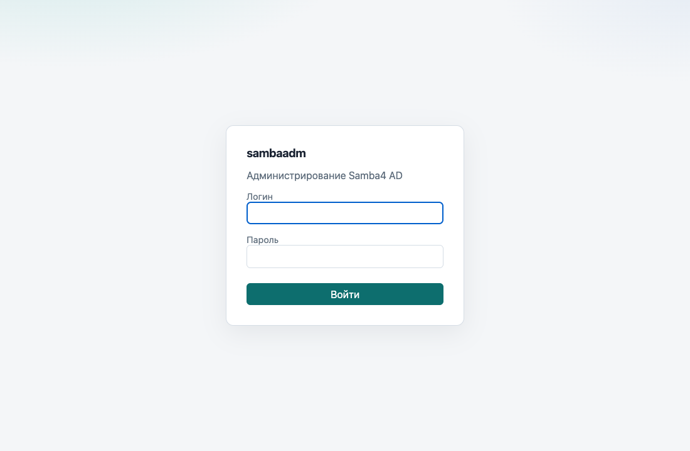
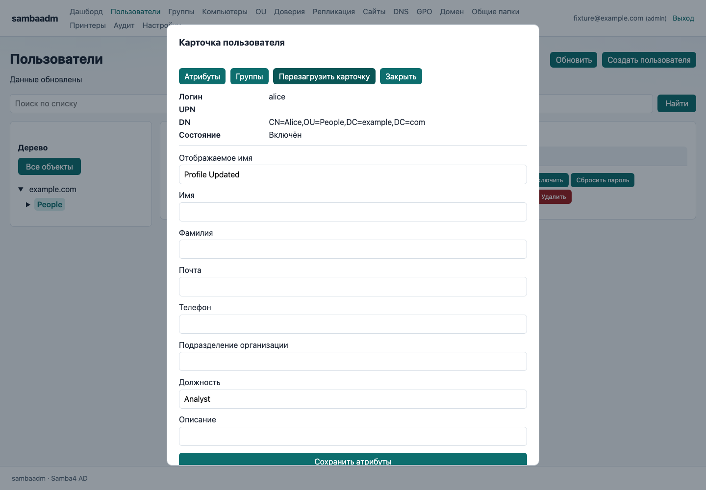
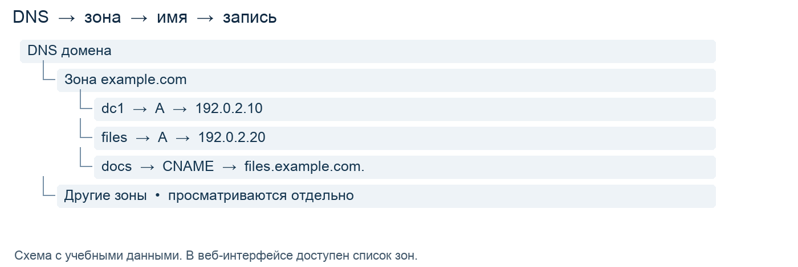
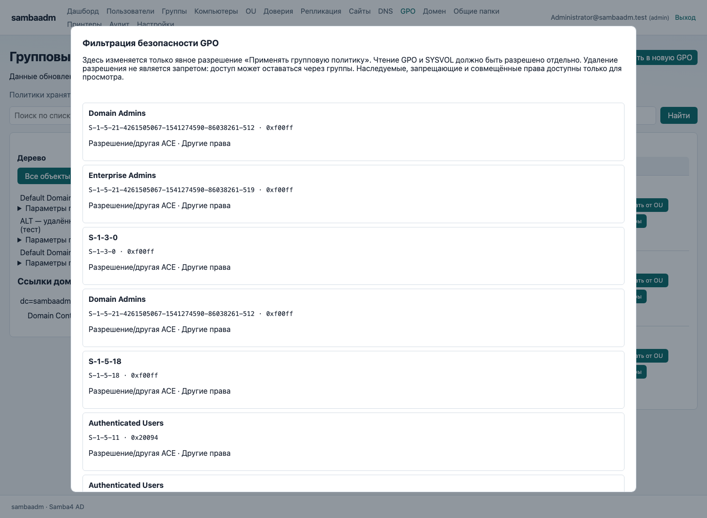
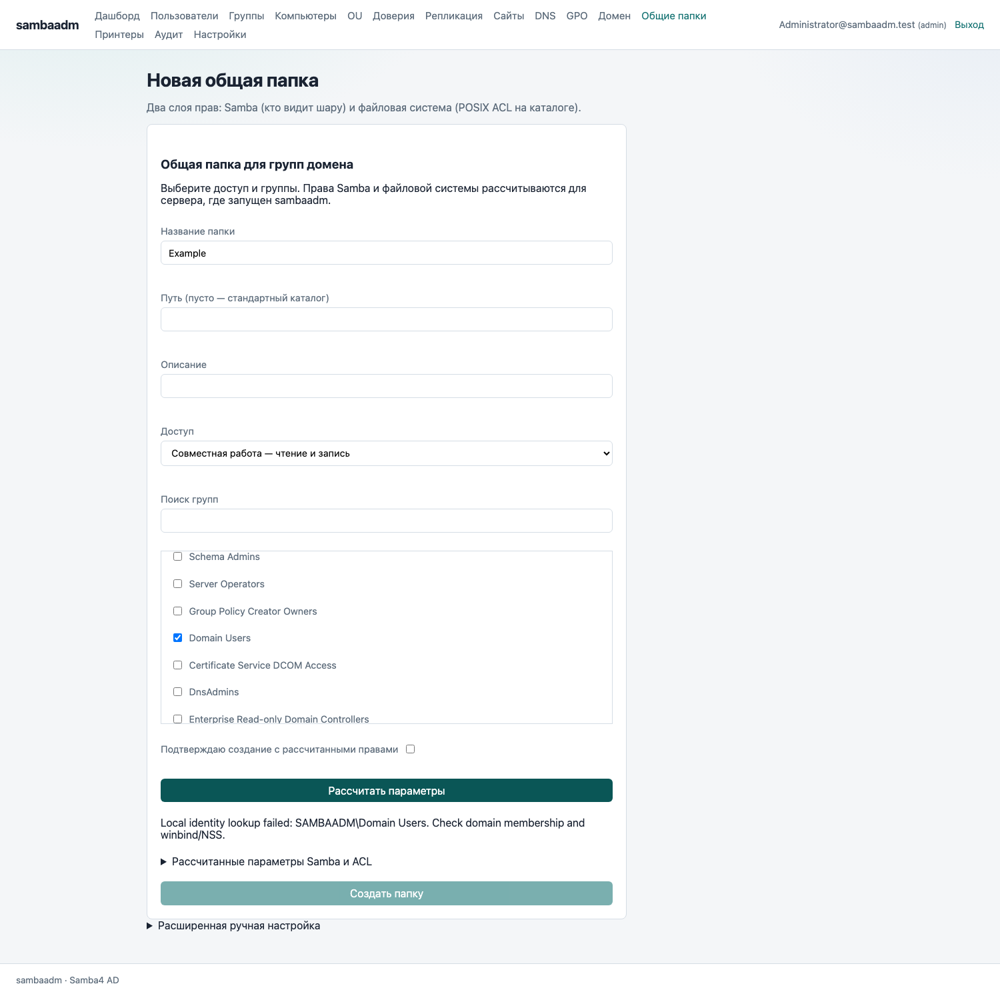

# Руководство администратора sambaadm

Редакция от 28 октября 2026 года для v0.25.0: редактор DNS, диагностика и пакетная установка ALT с обновлением и откатом.

[Иллюстрированная инструкция Word](admin-guide/sambaadm-admin-guide.docx). [Инструкция пользователя](user.md). [Подробности интерфейса](web.md).

Руководство предназначено для администратора существующего домена Samba AD. Приложение управляет доменом, но не создаёт его. Доменные операции используют LDAP, RPC и SMB без samba-tool. Общие папки, smb.conf, принтеры и системные метрики относятся к машине, где работает sambaadm.

## Пакетная установка на ALT

Для RPM используйте [установку, обновление и откат](alt-install.md). Пакет использует
`/usr/bin/sambaadm`, сохраняет конфигурацию через `%config(noreplace)` и содержит
`sambaadm-package` для обновления со снимком предыдущего RPM/YAML/env/overrides.
Следующий раздел описывает ручную установку бинарника.

## Установка и первый запуск

Скачайте бинарник и SHA256SUMS из [GitHub Releases](https://github.com/rkislov/sambaadm/releases). Для ALT на x86-64 нужен linux-amd64, для Mac M4 — darwin-arm64. Исходники текущей версии можно собрать командой `make build`; новые функции main отсутствуют в старом бинарнике релиза.

```bash
sha256sum sambaadm-linux-amd64
chmod +x sambaadm-linux-amd64
./sambaadm-linux-amd64 version
sudo install -m 755 sambaadm-linux-amd64 /usr/local/bin/sambaadm
sudo mkdir -p /etc/sambaadm /var/log/sambaadm
sudo cp configs/config.example.yaml /etc/sambaadm/config.yaml
```

Сравните сумму с SHA256SUMS для того же файла. Последняя команда предполагает наличие исходников проекта. Linux-сборки выпускаются с CGO_ENABLED=0: обновлять glibc ради бинарника не требуется. Работа политик на клиенте ALT СП 10.2.2 требует отдельной приёмки.

После настройки подключения выполните проверку и запуск:

```bash
sambaadm --config /etc/sambaadm/config.yaml serve --check
sambaadm --config /etc/sambaadm/config.yaml serve --listen=127.0.0.1:8081 --debug
```

Откройте http://127.0.0.1:8081/login на той же машине. Для сетевого доступа настройте HTTPS и адрес прослушивания. localhost в браузере всегда означает компьютер с браузером. Успешный --check подтверждает служебный LDAP Bind и чтение Base DN, но не проверяет все операции RPC, SMB и файловые права.

## Подключение и права

Используйте [полный пример конфигурации](../configs/config.example.yaml). Замените домен, DN групп и пути на реальные значения. Минимальные параметры:

```yaml
server:
  listen: "127.0.0.1:8081"
ldap:
  uri: "ldaps://dc1.example.com:636"
  ca_cert: /etc/sambaadm/domain-ca.pem
  base_dn: "DC=example,DC=com"
  bind:
    type: simple
    user: "svc-sambaadm@example.com"
    password_env: SAMBAADM_PASSWORD
auth:
  roles:
    admins:
      - "CN=Domain Admins,CN=Users,DC=example,DC=com"
    helpdesk:
      - "CN=Helpdesk,OU=Groups,DC=example,DC=com"
```

Служебная запись выполняет операции приложения; пароль входящего пользователя проверяется отдельным соединением. Задайте SAMBAADM_PASSWORD в окружении процесса. Для Bash можно использовать `read -r -s -p 'Пароль: ' SAMBAADM_PASSWORD`, затем `export SAMBAADM_PASSWORD`. В YAML пароль не записывайте.

Настройте доверие к CA и соответствие имени DC сертификату. Для браузера используйте server.tls.cert/key либо HTTPS на обратном прокси. YAML перечитывается после перезапуска; веб-настройки не заменяют настройку LDAP.

Роли сопоставляются с memberOf при входе: admin выполняет изменения, helpdesk включает и отключает пользователей и сбрасывает пароли, readonly читает данные. Если группы ролей не заданы, все вошедшие получают admin. В рабочем домене задайте группы явно; после изменения членства войдите заново. Роль приложения не заменяет права служебной записи в AD и права процесса в ОС.

## Вход и ежедневная проверка



1. Откройте адрес sambaadm, полученный при установке.
2. Введите UPN доменной записи, например ivanov@example.com, и её пароль. Стандартной пары admin/admin нет.
3. Проверьте роль, домен и сводку на главной странице. Ошибка получения данных не означает отсутствие объектов.
4. После работы нажмите «Выйти»; после перезапуска сервера может потребоваться повторный вход.

Дашборд показывает пользователей, GPO, компьютеры, включая DC, и контроллеры текущего домена. «Обновить сводку» повторяет запрос. Ошибка RPC или отсутствие партнёров не подтверждают исправность репликации. Карта соединений также не заменяет проверку состояния.

## Пользователи группы и подразделения



В «Пользователи» выберите контейнер слева, используйте поиск и «Обновить». «Все объекты» снимает ограничение дерева. Выбор OU показывает также вложенные объекты. В карточке сверяйте логин, UPN и DN перед изменением.

Admin создаёт пользователя, меняет имя, почту, телефон, должность, описание и другие доступные атрибуты. Пустое поле очищает атрибут. Логин, UPN и DN в карточке не переименовываются. Текстовое поле подразделения организации не переносит объект в OU — для этого есть отдельная операция.

На вкладке «Группы» выберите существующую группу и добавьте пользователя; исключение доступно из прямых групп. Основная группа выделена отдельно, вложенное членство не разворачивается. Изменения членства применяются сразу.

Helpdesk и admin могут включить или отключить запись и сбросить пароль с повторным вводом. Перенос в OU меняет область действия GPO. Компьютеры можно просматривать, переносить и удалять; OU — создавать, переносить и удалять, если это разрешает AD. Перед удалением убедитесь, что выбран нужный DN.

При конфликте карточки сохраните нужные введённые значения, перечитайте запись и повторите изменение после сравнения. Не отправляйте старую форму многократно.

## DNS и прочие доменные операции



1. Откройте DNS, выберите зону и раскройте «Имена записей».
2. Выберите имя и нажмите «Показать». Если дерево недоступно по правам LDAP, используйте ручной запрос записи.
3. Для создания задайте имя относительно зоны; @ обозначает корень. Поддерживаются A, AAAA, CNAME, MX, NS, PTR, SRV и TXT.
4. Для изменения укажите точное прежнее и новое значение. Проверьте результат повторным запросом.

Форматы сложных значений: SRV — `target port priority weight`, MX — `target preference`, TXT — строка в кавычках. Удаление зоны удаляет её содержимое; служебные зоны AD не используйте для экспериментов.

«Доверия» предоставляет создание, проверку и удаление доверия. «Домен» показывает свойства и FSMO, позволяет передавать или аварийно захватывать роли и повышать функциональный уровень. Захват FSMO и повышение уровня выполняйте только по отдельному плану обслуживания домена. Подтверждение формы не проверяет все организационные условия такой операции.

## Удалённый редактор политик ALT


В YAML включите gpo.editor_enabled и задайте gpo.smb_port: 445. LDAP и SMB должны обращаться к одному доступному writable DC. Локальный SYSVOL на Mac не требуется. Пустой gpo.admx_path означает загрузку BaseALT ADMX и ru-RU либо en-US ADML из SYSVOL/<domain>/Policies/PolicyDefinitions. Шаблоны не встроены в бинарник; подготовьте их отдельно. Можно указать локальный каталог или один ADMX.

1. Создайте отдельную GPO или сохраните резервную копию существующей.
2. Откройте «Параметры ALT», выберите Machine или User, шаблон и категорию в дереве. Поиск помогает найти параметр.
3. Выберите состояние и заполните поля: текст, число, список, переключатель или вариант перечисления. Прочитайте описание и ограничения диапазона.
4. Подтвердите сохранение, затем проверьте повторное чтение и нужные ссылки GPO.

Каталог поддерживает административные политики ALT, включая параметры помимо systemd. Его состав зависит от установленных ADMX/ADML. Неподдерживаемые конструкции доступны только для чтения. Редактор Windows ADMX и GPO Preferences XML не заявлен.

Сохранение обновляет Registry.pol, версию и связанные атрибуты через SMB/LDAP. При конфликте перечитайте параметры. При .sambaadm-editor.pending прекратите изменения и разберите незавершённую операцию по docs/web.md; не удаляйте журнал вслепую. Применение на ALT СП 10.2.2 и одновременная работа с GPUI ещё требуют проверки.

## Область действия и наследование GPO


1. В разделе GPO нажмите «Область действия» либо выберите домен или OU в дереве.
2. Добавьте существующую политику из списка. Кнопками вверх и вниз задайте порядок; 1 — наивысший приоритет внутри контейнера.
3. При необходимости отключите ссылку, включите принудительное применение или блокировку наследования контейнера.
4. Изучите кандидатов и причины исключения, подтвердите и сохраните изменения.
5. Проверьте ссылки повторным открытием, затем применение на тестовом клиенте.

Принудительные ссылки предков сохраняют действие через блокировку наследования. Отключённая ссылка исключается. Изменение ссылки не удаляет саму GPO. При HTTP 409 перечитайте контейнер и согласуйте изменения с другим администратором.

Предпросмотр не является RSoP: он не вычисляет сайт компьютера, токен безопасности, членство в группах, WMI, loopback и результат выполнения расширений. Разделы Machine/User и ссылка WMI отображаются отдельно. Не считайте верхний элемент списка доказательством применения настройки на конкретном компьютере.

### Моделирование результирующей политики ALT и Windows

В разделе GPO выберите «Моделирование политики». Расчёт доступен readonly, helpdesk и admin, читает LDAP и SYSVOL и не изменяет объекты или настройки. Требуются включённый gpo.editor_enabled, шаблоны ALT ADMX/ADML и SMB-доступ к SYSVOL, как для редактора ALT.

Выберите пользователя и/или компьютер либо домен/OU для условного получателя. Дополнительная OU моделирует перенос без изменения каталога. Loopback задаётся явно: None, Merge или Replace. Для Merge/Replace нужны оба получателя; в Merge пользовательские параметры из расположения компьютера имеют более высокий приоритет.

Задайте допущения безопасности и WMI для всех GPO или отдельно по GUID политики. «Разрешено / истина» включает право применения и чтение GPO/SYSVOL; «Запрещено / ложь» исключает политику. По умолчанию условия неизвестны: GPO исключается, а раздел помечается как неполный. Эти условия общие для Machine и User; членство в группах, ACL и WMI на клиенте автоматически не проверяются.

Нажмите «Рассчитать результат». Отчёт учитывает ссылки домена/OU, порядок, Enforced, блокировку наследования, отключённые ссылки и разделы. Итоговые состояния и значения ALT вычисляются из Registry.pol по шаблонам ADMX/ADML; источниками разных значений одного параметра могут быть разные GPO. Ненастроенный параметр в одной GPO не отменяет значение другой.

Строки с разными значениями одного параметра реестра выделены цветом и подписью «Конфликт». Сведения о конфликте показывают конкурирующие значения, победившую GPO, контейнер, Enforced и порядок ссылки. Установка и удаление значения также конфликтуют; одинаковые значения разных GPO не подсвечиваются. Раскройте Registry.pol для параметров без шаблона ALT.

Скачайте отчёт JSON для сохранения сценария, допущений, источников и конфликтов. После изменения сценария старый отчёт скрывается: запустите расчёт снова. Ошибки чтения, неизвестные условия и неподдерживаемые директивы дают неполный результат; победители в нём могут измениться после устранения причин.

Это ограниченная модель RSoP. Политики сайта и локальные политики, скрипты, Preferences, security templates, медленные соединения и остальные клиентские расширения не вычисляются. Поддержка loopback и фактическое применение зависят от движка ALT/Windows-клиента. Проверяйте результат на тестовом клиенте. Подробности и формат API: docs/web.md и docs/api.md.

## Фильтрация и резервные копии GPO



«Фильтрация безопасности» показывает SID, имя, тип ACE и право Apply Group Policy. Выберите пользователя, компьютер или группу безопасности и добавьте явное разрешение применения. Можно удалить отдельную явную разрешающую ACE этого права. Наследуемые, запрещающие и совмещённые записи оставлены для просмотра; остальные права сохраняются.

Эта операция не предоставляет Read и не меняет файловые ACL SYSVOL. Проверьте право чтения отдельно. Удаление разрешения не означает запрет: доступ может оставаться через другую группу. После изменений проверьте реальный клиент.

«Резервная копия» сохраняет данные на сервере приложения. Для восстановления в новую GPO укажите имя и каталог копии, затем создайте нужные ссылки отдельно. Используется нативный формат sambaadm-backup.json; старый формат .SAMBABACKUP несовместим. Не считайте локальную копию резервированием, пока она не перенесена в защищённое хранилище и не проверено восстановление.

«Доставить на контроллеры» запускает серверное задание с прогрессом. Закрытие окна не отменяет его. gpo.sync_mode задаёт drs, smb или both. DRS передаёт каталог AD, но не файлы SYSVOL; для файлов нужна SMB-доставка. Сохранение и доставка не доказывают применение: выполните проверку gpupdate/gpresult и фактических настроек на тестовом клиенте ALT.

## Сайты и карта репликации


В «Сайты» управляйте сайтами, подсетями CIDR, размещением DC и IP Site Links. Для связей выбирайте существующие сайты. Стоимость — 1–32767; интервал — 15–10080 минут с шагом 15. Перед удалением сайта перенесите DC, переназначьте подсети и исключите сайт из связей.

В «Репликация» или «Сайты» нажмите «Топология». Сплошная стрелка — включённое соединение, пунктир — отключённое. Для нового направления перетащите источник на назначение, нажмите два узла по очереди либо выберите DC в списках. Проверьте направление и подтвердите создание. Самосвязь и дубликат запрещены.

В списке соединений доступны включение, отключение, удаление и расписание. Расписание задаётся в UTC, начиная с воскресенья: 08:15-12:00,13:00-18:45; пустой день закрыт, 00:00-24:00 открыт. Это окно доступности, а не точное время запуска. Запись расписания Site Link отключена из-за выявленной несовместимости KCC; расписание соединения настраивается отдельно.

Проверьте состояние репликации: партнёра, раздел, последний успех и последовательные ошибки. При необходимости выполните синхронизацию раздела и пересчёт KCC после распространения Configuration. KCC может пересоздавать автоматические соединения. Карта отражает конфигурацию, а не исправность транспорта.

## Общие папки и доменные группы



1. Настройте samba.smb_conf, samba.shares_root и samba.reload_cmd на сервере приложения. Процессу нужны права на конфигурацию и каталоги.
2. Откройте «Общие папки → Создать папку», задайте имя и описание. Пустой путь использует стандартный корень.
3. Выберите режим совместной работы или чтения и группы из подключённого домена.
4. Нажмите «Рассчитать параметры». Проверьте группы, права записи, маски и файловые ACL. Технические параметры доступны в раскрываемом блоке.
5. Устраните ошибки локального разрешения групп, затем подтвердите создание и проверьте доступ с клиентского компьютера.

Группы Samba задаются квалифицированными именами домена, POSIX ACL — числовыми GID. На Linux нужны настроенные NSS/winbind, getent, setfacl и файловые права. LDAP-подключение с Mac само по себе этого не обеспечивает. Если группа не разрешается на сервере, создание блокируется — как на иллюстрации.

Доступ должен разрешаться и Samba, и файловой системой. В мастере гостевой доступ запрещён. Расширенная ручная форма остаётся отдельной ветвью. Удаление публикации по умолчанию сохраняет каталог и данные. Принтеры также локальны: публикация требует существующей очереди CUPS и доступных утилит печати.

## Профили Samba и показатели системы


В «Настройки → Профили Samba» выберите профиль и нажмите «Предпросмотр профиля». Совместимый разрешает SMB2_02 и выше с обязательной подписью. Защищённый требует SMB3_11, подпись и шифрование; старые клиенты могут потерять доступ. Это расчёт параметров по профилю, не автоматическая настройка под оборудование.

После просмотра подтвердите запись. Проверяются testparm и версия файла; сохраняется резервная копия .sambaadm-<UTC timestamp>.bak. Доменная роль, realm, idmap и секции папок не переписываются. include, registry backend и неоднозначная конфигурация блокируют автоматическую запись. Затем отдельно перечитайте конфигурацию Samba; некоторым параметрам нужен перезапуск службы. Для отката используйте созданную копию, повторную проверку testparm и штатное применение конфигурации.

Графики показывают CPU, занятую RAM и заполнение системного диска сервера sambaadm. Диск — не скорость ввода-вывода. Замеры идут каждые 5 секунд при открытом дашборде; хранятся последние 120 точек в памяти. Перезапуск очищает историю, скрытая вкладка не опрашивает сервер. «Нет замера» не равно нулевой нагрузке. При запуске в контейнере доступны метрики его среды, а не удалённого DC.

## Обслуживание и диагностика

Для постоянного запуска адаптируйте deploy/sambaadm.service. Создайте пользователя и группу сервиса, выдайте доступ к YAML, CA и журналу; задайте пароль в /etc/sambaadm/env с правами 0600. Шаблон сервиса разрешает запись только в /var/log/sambaadm. Для локальных папок и smb.conf отдельно настройте права ОС и ReadWritePaths; одного добавления пути недостаточно для выдачи файловых прав. После установки unit выполните daemon-reload и enable --now sambaadm.

```bash
sambaadm --config /etc/sambaadm/config.yaml serve --debug
sambaadm --config /etc/sambaadm/config.yaml serve --check
journalctl -u sambaadm -b -f
```

Debug показывает версию, выбранную конфигурацию, адреса, пути, наличие переменной пароля и ошибки подключения. Сам пароль не выводится. При передаче журнала в поддержку проверьте его на внутренние адреса и имена. Аудит действий хранится по audit.file; включите его в политику хранения журналов.

- Страница не открывается: проверьте процесс, listening, порт, адрес и межсетевой экран. 127.0.0.1 доступен только локально.
- Вход не проходит: проверьте служебный пароль, UPN, LDAPS, CA, DNS и Base DN. Локальный пароль ОС не заменяет доменный.
- 401: войдите повторно. 403: проверьте роль и обновите сессию/форму; роль не выдаёт права AD автоматически.
- 409: перечитайте изменённый объект или файл, сравните значения и повторите действие.
- RPC или SMB недоступны: проверьте DNS DC, маршруты, соответствующие порты и права служебной записи.
- Папка не создаётся: проверьте NSS/getent, GID, setfacl, smb.conf и права сервиса.
- GPO сохранена, но не действует: проверьте ссылки, раздел Machine/User, Read и Apply, SYSVOL на целевом DC и результат обработки на клиенте.

Перед обновлением сохраните YAML, секреты в защищённом хранилище, smb.conf и резервные копии GPO. Проверьте новый бинарник и вход, чтение каталога, тестовую операцию и журнал. При проблеме верните предыдущий бинарник и конфигурацию по принятой процедуре обслуживания.

## Структурированный редактор DNS

Откройте DNS, выберите зону и «Записи», либо имя в дереве зоны. Таблица показывает записи выбранного узла; `@` обозначает корень зоны. Для другого имени используйте поле запроса и фильтр типа.

Администратор может добавить запись или изменить/удалить конкретное значение из строки. Для MX вводятся почтовый сервер и приоритет, для SRV — сервер, порт, приоритет и вес. TXT использует DNS-синтаксис с кавычками, например `"текст"`. SOA доступна для просмотра. Сохранение и удаление требуют подтверждения; ошибки остаются в открытой форме.

Смена имени или типа выполняется созданием новой записи и удалением старой. Изменение передаёт исходное значение записи; TTL сейчас сохраняется по существующему механизму RPC (новые данные получают TTL 900 секунд), отдельного редактора TTL нет.

## Диагностика подключения

Администратор открывает **Диагностика** (`/diagnostics`) и нажимает «Запустить проверки». Проверки идут параллельно, с отдельными таймаутами и защитой от одновременного повторного запуска. Без JavaScript форма тоже работает.

Проверяются служебный LDAP Bind и чтение Base DN, доверие сертификату LDAPS, разрешение имени контроллера и DNS SRV, чтение SYSVOL по SMB, локальный smb.conf через testparm, каталог общих папок, зависимости ACL/xattr/CUPS и эффективные права записи на Linux. Удалённые проверки используют отдельное соединение и служебные реквизиты. Отсутствие локальных Samba-утилит отмечается отдельно от доступности удалённого AD.

Статусы: успешно, ошибка, требует внимания, пропущено, информация. Успешное чтение SYSVOL не подтверждает запись, репликацию или применение GPO; эти ограничения показаны в результатах. Проверка прав не создаёт файлов и не меняет ACL. Подробные технические сообщения и рекомендации выводятся на английском, названия проверок и статусы — на выбранном языке интерфейса.

API: `POST /api/v1/system/diagnostics`, роль admin, session cookie и `X-CSRF-Token`. HTTP 200 содержит результаты, включая неуспешные проверки; 409 означает, что другой запуск ещё выполняется.
