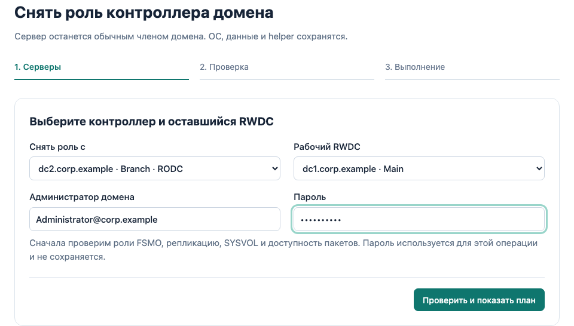
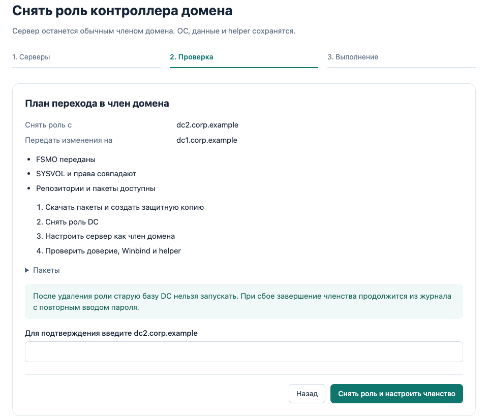
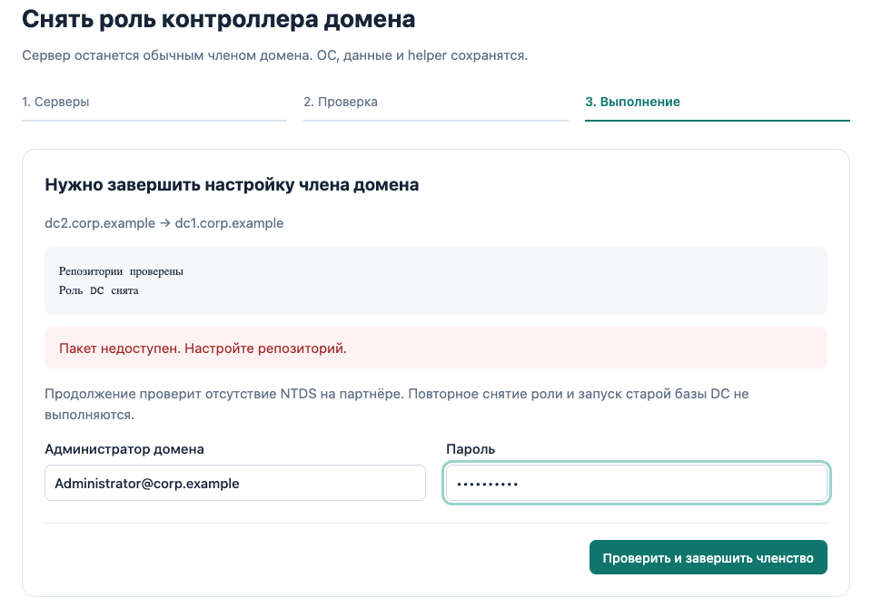

# Снятие роли DC с сохранением членства в домене

Версия 0.52.0 от 25 ноября 2026 года. Мастер переводит работающий RWDC или RODC на ALT Linux p10/p11 в обычный сервер — член того же домена. Операционная система, пользовательские данные и зарегистрированный helper сохраняются.

## Перед началом

Выберите другой доступный RWDC этого домена с глобальным каталогом и копиями всех разделов AD, включая DomainDnsZones и ForestDnsZones. Последний RWDC снять таким способом нельзя. Передайте все FSMO-роли через раздел «Роли FSMO». Проверьте репликацию и согласованность SYSVOL; при расхождении сначала доставьте GPO из панели.

На целевом сервере и выбранном RWDC должен работать зарегистрированный helper той же версии, что панель. Helper RWDC вычисляет эталон содержимого SYSVOL и прав, а helper целевого DC сверяет локальные данные с этим эталоном. Рекомендуется HTTPS с проверенным доменным именем и доверенным CA. Если панель работает на снимаемом DC или использует его LDAP, сначала перенесите панель/выберите другой LDAP-сервер. Удаление метаданных неработающего DC — отдельный сценарий; этот мастер предназначен для живого контроллера.

Автоматический переход рассчитан на стандартные `/etc/samba/smb.conf`, `/var/lib/samba` и `/var/lib/samba/private`. Если настроены дополнительные SMB-ресурсы, нестандартные пути AD, NSS/SSSD или пересекающиеся локальные UID, мастер остановится до изменения роли. Сначала согласуйте перенос ресурсов и модель UID/GID: член домена использует Winbind и RID. Произвольные права файлов не пересчитываются автоматически.

Проверьте свободное место: мастер делает локальную холодную защитную копию перед снятием роли и отдельно сохраняет выведенную базу DC. Это не замена независимой резервной копии домена.

## Выбор серверов и предпросмотр

1. Откройте «Сайты и службы», затем серверы нужного сайта.
2. В карточке контроллера выберите «Снять роль DC». Действие также доступно над списком серверов.
3. Выберите целевой DC и оставшийся рабочий RWDC. Введите логин администратора домена и пароль.
4. Нажмите «Проверить и показать план». Проверяются идентичность сервера, роли, разделы AD, SYSVOL вместе с правами, настройки ОС, репозитории и все необходимые пакеты. При недоступном источнике настройте `/etc/apt/sources.list` и `sources.list.d` для своей версии ALT и архитектуры; автоматической подмены зеркал нет.

Проверьте оба имени и шаги. Снятие роли выполняется только после ввода точного DNS-имени целевого контроллера. Пароль используется внутри операции, не передаётся в командной строке ОС, не сохраняется в журнале, файлах задания или хранилище браузера.

## Выполнение и результат

Перед изменением роли сервер повторно проверяет план, скачивает все пакеты, сохраняет конфигурацию и холодную копию базы. RWDC передаёт изменения всех разделов AD выбранному партнёру. Для RODC исходящая репликация не требуется.

Затем выполняется штатное снятие роли Samba. Проверяются удаление NTDS и переход исходной учётной записи компьютера в состояние члена домена. Пустой объект сервера и оставшаяся специальная запись krbtgt RODC удаляются только при совпадении сохранённых идентификаторов и отсутствии чужих привязок. Обычные адресные записи сервера сохраняются, служебные записи DC не восстанавливаются.

Старая база отделяется от рабочего состояния Samba. Службы AD DC и BIND блокируются от автоматического запуска. Сервер получает DNS оставшегося RWDC, конфигурацию члена домена, Winbind, NSS и PAM. Сертификат и связь helper сохраняются. При хранении его TLS внутри каталога Samba необходимые файлы переносятся в защищённый каталог helper.

Успех показывается после проверки учётной записи компьютера в AD, машинного доверия, поиска доменного пользователя и работающего helper. Само исчезновение контроллера из списка ещё не означает успешное членство. В автоматических проверках релиза дополнительно выполняется настоящий доменный вход через PAM.

Защитные копии и журнал находятся на целевом сервере: `<helper.state_dir>/dc-demote/<номер задания>/`, права каталога 0700. Сохраняйте журнал до окончания проверки. Пользовательские файлы вне состояния Samba не удаляются.

## Сбой, повторное открытие и продолжение

Закрытие браузера не прерывает задание. После возвращения в мастер откроется его журнал; в браузере сохраняется только номер задания и имена серверов. Панель сохраняет подтверждённый helper адрес для продолжения HTTPS-связи при временном отсутствии DNS-имени; проверка имени сертификата и CA остаётся включённой.

Если проверка остановилась до снятия роли, исправьте причину и выполните новый предпросмотр. Если роль уже удалена, нажмите «Проверить и завершить членство» и снова введите учётные данные. Продолжение проверяет состояние на партнёре и выполняет только оставшиеся шаги; штатное снятие роли повторно не запускается.

Если результат удаления NTDS не подтверждён, мастер требует проверки AD. Не снимайте блокировку службы и не запускайте старую базу DC после удаления его метаданных: автоматический возврат такой копии в домен не выполняется. Исправьте связь с выбранным партнёром и повторите безопасное продолжение. При повреждении локальной защитной копии или неожиданном изменении объектов AD сначала разберите журнал.

[Развёртывание нового леса и контроллеров](domain-init.md) · [Руководство администратора](admin.md) · [Helper](helper.md) · [Восстановление домена](domain-recovery.md) · [Плагин Caja](caja-plugin.md).
