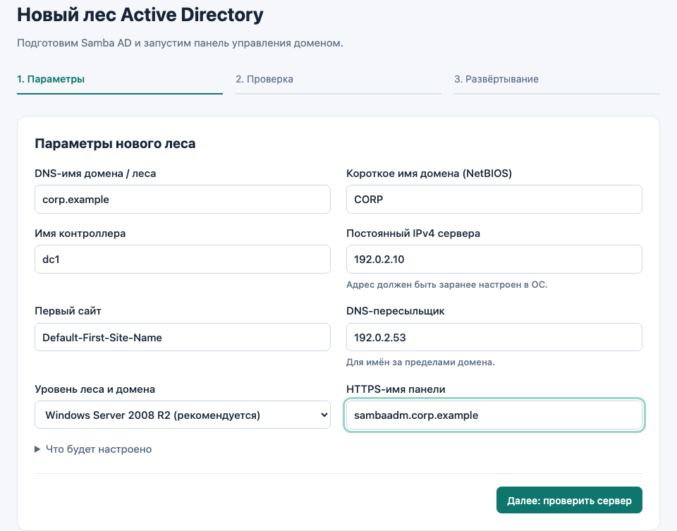
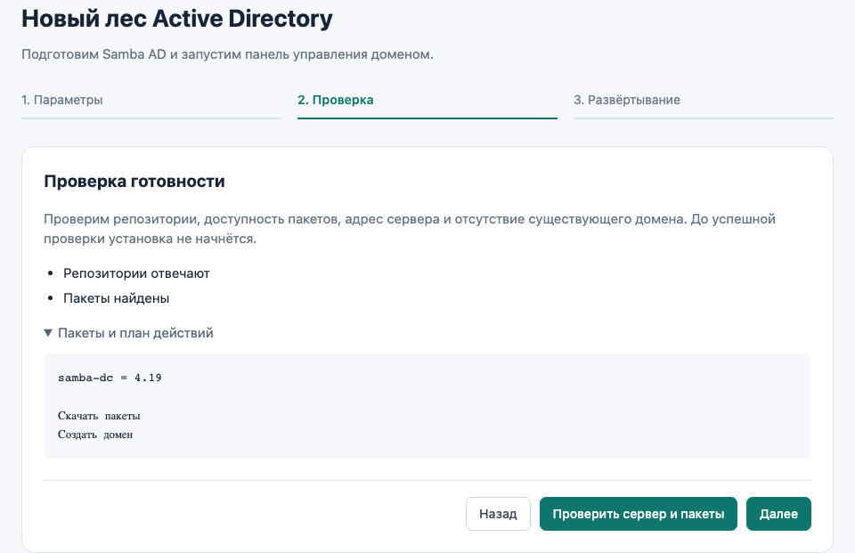
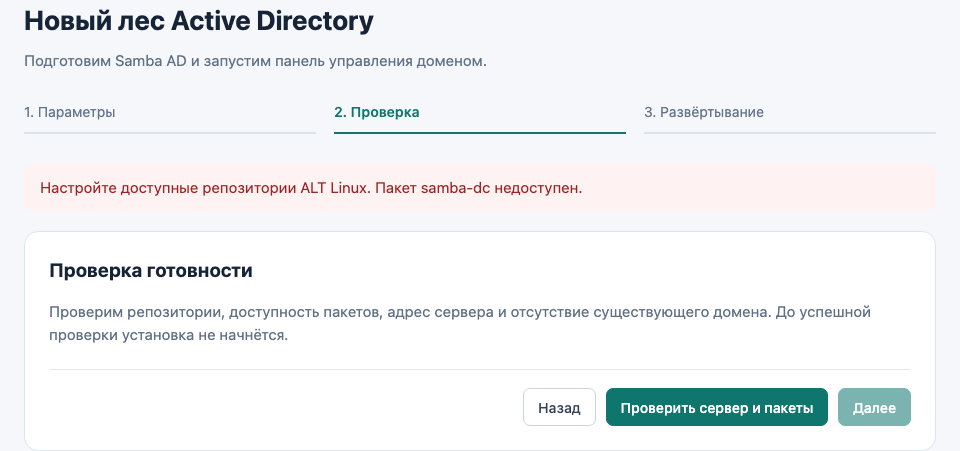
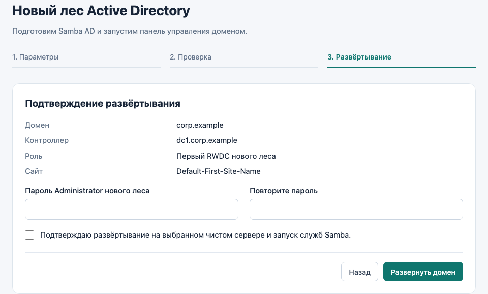
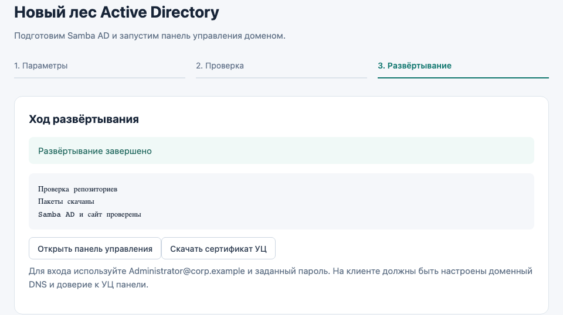
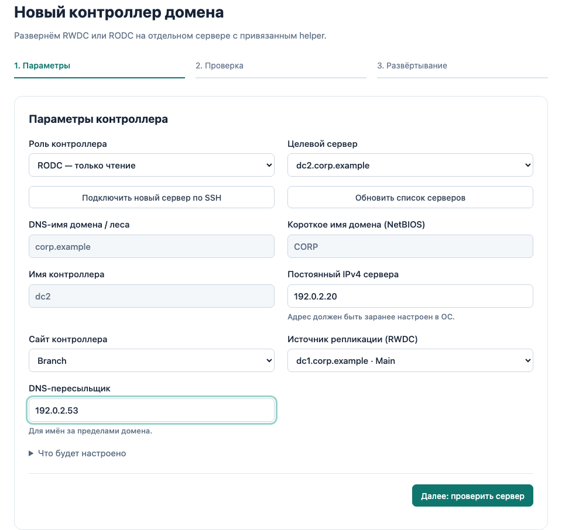
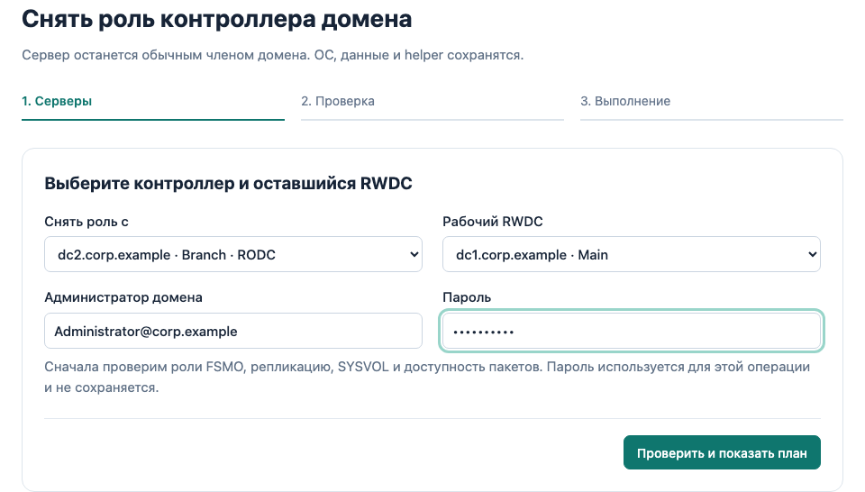
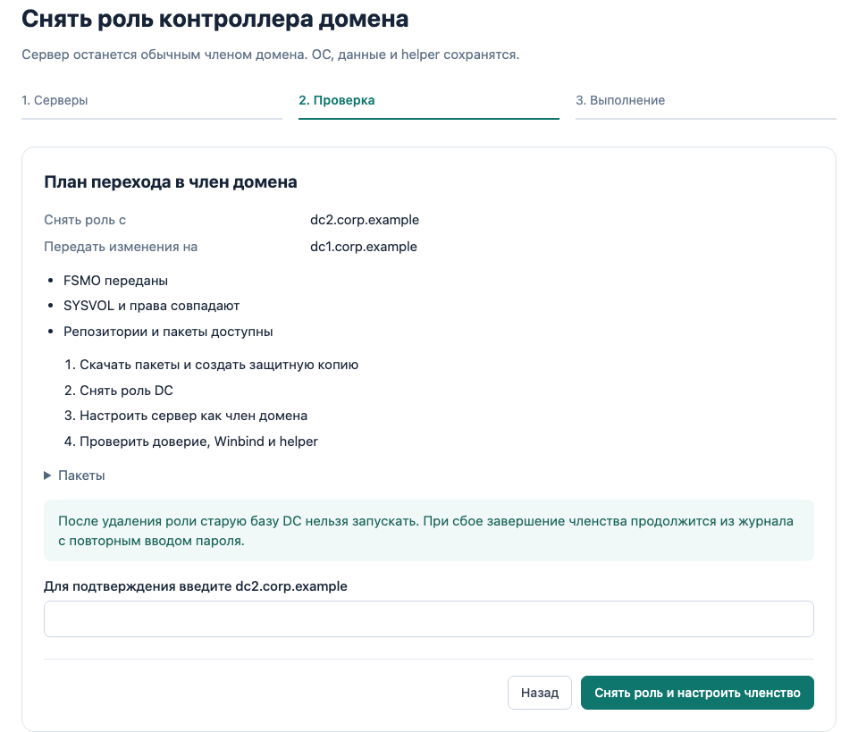

# Развёртывание и снятие роли контроллеров Samba AD

Версия 0.52.0 от 25 ноября 2026 года. Инструкция для администратора: создание нового леса, добавление RWDC или RODC, подключение helper и проверка результата. Мастер проверяет репозитории и пакеты до установки; при ошибке источников сначала исправьте их доступность.

[Иллюстрированная инструкция Word](domain-init-guide/sambaadm-domain-init-guide.docx). [Руководство администратора](admin.md). [Быстрая установка](quick-install.md).

Иллюстрации показывают настоящий интерфейс мастера на учебных данных. Домен `corp.example`, адреса `192.0.2.10`, `192.0.2.20` и `192.0.2.53` приведены для примера; замените их своими. Версии пакетов на иллюстрациях не являются требованием к репозиторию.

## Выбор сценария

Если домена ещё нет, установите полный RPM sambaadm на чистый сервер ALT Linux и запустите `sudo samba-domain-init`. Откроется отдельный HTTPS-мастер нового леса и первого записываемого контроллера.

Если домен уже работает и нужен ещё один DC, войдите администратором в панель и откройте **Сайты и службы → Развернуть контроллер**. Выберите RWDC для записываемого контроллера или RODC для контроллера только для чтения. Новый сервер подключается через helper.

Если нужно только установить панель управления существующим доменом, используйте `sudo sambaadm-setup`. Эта команда настраивает доступ панели, HTTPS и службу, но не создаёт лес и не присоединяет DC. Обычное обновление RPM также не выполняет развёртывание домена.

## Подготовка сервера и сети

Подготовьте отдельный сервер ALT Linux с работающим systemd и правами root. Для первого леса нужен полный RPM sambaadm со встроенным RPM helper той же версии. Python 3 устанавливается как зависимость пакета. Создание леса и присоединение RWDC/RODC проверяются на ALT p10 и p11, x86_64 и ARM64.

Заранее задайте постоянный IPv4 в ОС и настройте синхронизацию времени. Поле адреса в мастере проверяет уже назначенный IP, а не меняет сетевую конфигурацию. Для дополнительного DC время должно совпадать с доменом, а доменный DNS — разрешать имя исходного RWDC.

На целевой машине не должно быть рабочих баз Samba и запущенных служб Samba или BIND. Изменённый `smb.conf` не заменяется автоматически. Условие начала проверки — не менее 2 ГиБ свободного места в `/var/lib`; фактический запас рассчитывайте по размеру AD и SYSVOL.

Мастер использует стандартные каталоги ALT Linux: `/etc/samba/smb.conf`, `/var/lib/samba` и SYSVOL. Выбор другого размещения баз и SYSVOL в этой версии не предусмотрен. Сетевые настройки и время подготавливаются средствами ОС.

Нужен обычный `/etc/resolv.conf`, который не будет перезаписан сетевой службой. После запуска Samba мастер сохранит исходный файл и направит DNS сервера на `127.0.0.1`. Если файл является символической ссылкой, мастер предложит сначала подготовить DNS в ОС.

Для Samba AD разрешите штатные доменные соединения, включая DNS, Kerberos, LDAP/LDAPS, SMB, RPC и динамический RPC-диапазон. Для первого мастера нужен TCP/8445, панели — TCP/443, подключения нового helper — SSH и HTTPS helper, обычно TCP/22 и TCP/8444. Доступ к панели и helper ограничьте административной сетью.

## Проверка репозиториев и установка панели

Используйте репозитории для своей версии ALT и архитектуры. Источники настраиваются в `/etc/apt/sources.list` и `/etc/apt/sources.list.d/`. Проверьте DNS, маршрут и доступ к выбранным зеркалам. Не смешивайте ветки и архитектуры.

До установки RPM выполните:

```sh
sudo apt-get update
apt-cache policy python3 openssl samba-dc samba-common-tools \
  python3-module-samba bind-utils
```

Проверьте сообщения обновления: наличие ошибок получения индексов или разрешения имён означает, что источники ещё не готовы. Один только код завершения `apt-get update` не подтверждает доступность всех источников. Для нужных пакетов должен быть указан кандидат установки; `(none)` означает отсутствие кандидата.

Если репозиторий или пакет недоступен, **остановите установку и настройте доступный репозиторий**. Повторите проверку после исправления сети, DNS или списка источников. Мастер не подменяет зеркала и не отключает проверку пакетов.

Скачайте RPM и `SHA256SUMS` из одного [релиза sambaadm](https://github.com/rkislov/sambaadm/releases/tag/v0.52.0). Сверьте контрольную сумму RPM с манифестом. Для x86_64:

```sh
sudo apt-get install ./sambaadm-0.52.0-alt1.x86_64.rpm
```

Для ARM64 используйте файл `sambaadm-0.52.0-alt1.aarch64.rpm`. Архитектуру сервера показывает `uname -m`.

Внутри мастера проверка повторяется: обновляются индексы, проверяются кандидаты пакетов и план зависимостей. План с удалением установленного ПО отклоняется. Перед изменением служб и конфигурации скачиваются все необходимые RPM; ошибка скачивания останавливает развёртывание.

## Запуск мастера нового леса

На подготовленном чистом сервере выполните:

```sh
sudo samba-domain-init
```

Эквивалентная команда — `sudo sambaadm domain-init`. По умолчанию мастер слушает все IPv4-адреса на порту 8445. Для явного указания адреса:

```sh
sudo samba-domain-init --listen 0.0.0.0:8445
```

Консоль выведет HTTPS-адрес, временный код доступа и SHA-256 сертификата. Откройте адрес со своей административной машины, сверьте отпечаток сертификата с консолью и введите код. Код не передаётся в URL; доступ ограничен двумя часами. Это временный мастер: для постоянной панели после развёртывания будет выпущен отдельный HTTPS-сертификат с доменным именем.

## Параметры нового леса



Укажите **DNS-имя домена / леса**, например `corp.example`, и **Короткое имя домена (NetBIOS)**, например `CORP`. Для первого DC задайте отдельное короткое имя, например `dc1`: оно не должно совпадать с NetBIOS домена. Полное имя контроллера получится `dc1.corp.example`.

В поле **Постоянный IPv4 сервера** введите адрес его интерфейса. Укажите **Первый сайт** и доступный **DNS-пересыльщик** для внешних имён. В примере используются стандартное имя первого сайта и адрес пересыльщика `192.0.2.53`.

Выберите уровень леса и домена. Доступны поддерживаемые мастером уровни 2003, 2008 и 2008 R2; по умолчанию — 2008 R2. Поле **HTTPS-имя панели** должно содержать DNS-имя в новом домене, например `sambaadm.corp.example`.

Первый DC будет записываемым. Первоначально используется встроенный DNS Samba и включается RFC2307. После развёртывания BIND9 DLZ можно включить через **DNS → Маршрутизация DNS**.

## Проверка и подтверждение нового леса

Нажмите **Далее: проверить сервер**, затем **Проверить сервер и пакеты**. Пока проверка не прошла, кнопка **Далее** недоступна. Раскройте **Пакеты и план действий**, чтобы проверить будущую операцию.



При недоступном источнике или пакете мастер покажет причину. Исправьте доступ к репозиторию и повторите проверку. Не переходите к ручному созданию домена поверх незавершённого задания.



После успешного предпросмотра нажмите **Далее**. Проверьте домен, имя DC, его роль и сайт. Задайте и повторите пароль `Administrator`. Требуются не менее восьми знаков и как минимум три группы символов: прописные, строчные, цифры, специальные знаки.



Отметьте подтверждение работы на выбранном чистом сервере и нажмите **Развернуть домен**. Перед применением мастер повторно проверит параметры сервера, репозитории и пакеты. Если они изменились после предпросмотра, получите новый план.

## Результат создания леса

Следите за разделом **Ход развёртывания**. Мастер устанавливает Samba AD DC, создаёт каталог и SYSVOL, назначает первый сайт, запускает Samba и проверяет LDAP, DNS SOA/SRV, роль и сайт контроллера.

Для панели создаётся отдельная запись `svc-sambaadm` со случайным паролем, административными правами домена и без автоматического истечения срока пароля. Её пароль сохраняется штатным `sambaadm-setup` в защищённой конфигурации службы. Пароль `Administrator` туда не записывается. Ротацию служебной записи планируйте как отдельную административную операцию.

Создаются DNS-запись имени панели и HTTPS-сертификат. Helper первого DC устанавливается и привязывается автоматически; его регистрация сохраняется только после успешной проверки TLS, подписи и имени узла.



Откройте панель по указанному HTTPS-имени. На административной машине должны быть настроены доменный DNS и доверие к УЦ панели. После завершения доступна кнопка **Скачать сертификат УЦ**; распространяйте только публичный сертификат, закрытый ключ УЦ передавать нельзя.

Войдите как `Administrator@ВАШ-ДОМЕН` с заданным паролем. Проверьте **Сайты и службы**, список контроллеров и регистрацию helper. Вход по логину и паролю сохраняется; Kerberos SSO настраивается дополнительно через отдельный keytab HTTP по [инструкции HTTPS и SSO](alt-install.md#kerberos-sso-и-https).

## Добавление RWDC или RODC

В работающей панели создайте нужный сайт и подсети в **Сайты и службы**, если их ещё нет. Подготовьте новый чистый сервер по требованиям выше. Для SSH и последующего HTTPS helper его полное DNS-имя должно разрешаться в правильный IPv4: при необходимости заранее создайте A-запись нового сервера в разделе DNS панели.

Откройте **Сайты и службы → Развернуть контроллер**. Если helper ещё не зарегистрирован, нажмите **Подключить новый сервер по SSH**. Укажите полное имя нового сервера в текущем домене, проверьте SSH и сверьте отпечаток ключа с доверенной консолью сервера.

Мастер helper запросит SSH-логин, SSH-пароль и пароль `su -`. При SSH-входе сразу под root второй пароль не требуется. Установка включает проверку пакета, выпуск HTTPS-сертификата и проверенную привязку helper. Результат и журнал показываются по каждому узлу; подробности — в [инструкции helper](helper.md#установка-на-выбранные-контроллеры-через-ssh).

Вернитесь в мастер контроллера, нажмите **Обновить список серверов** и выберите целевой сервер. Уже действующие DC исключаются из списка новых узлов. Имя создаваемого DC должно совпадать с DNS-именем зарегистрированного helper.



Выберите **RWDC — записываемый** или **RODC — только чтение**. Домен и NetBIOS берутся из текущего AD. Укажите IPv4, существующий сайт, исходный записываемый DC и DNS-пересыльщик. Назначение сайта задаётся до присоединения, перемещать готовый DC после установки для этого не нужно.

Нажмите **Далее: проверить сервер** и **Проверить сервер и пакеты**. После успешной проверки укажите доменную учётную запись с правами присоединения DC и её пароль, повторите пароль, проверьте сводку и подтвердите запуск.

До первого запуска переносится начальный SYSVOL с исходного RWDC. Мастер сверяет версии GPO в LDAP, содержимое и права доступа. Это начальная доставка, а не постоянная репликация DFSR. Последующие изменения доставляйте существующими средствами SYSVOL в панели.

В конце проверяются локальный LDAP, SOA/SRV, роль DC/RODC и выбранный сайт. Для RODC отдельно настройте политику кэширования и, если нужно, заполнение кэша в **Кэш и авторизации RODC**. Присоединение RODC само по себе не разрешает кэширование всех пользователей.

## Сертификаты и проверка готовности

Каждый новый DC создаёт закрытый ключ на своей машине. Панель подписывает CSR общим локальным УЦ sambaadm и до первого запуска LDAPS устанавливает сертификат с DNS-именем в SAN на 10 лет. Закрытые ключи дополнительных DC не передаются серверу панели. В первом лесу этот же УЦ используется панелью и локальным helper.

После завершения проверьте вход в панель, роль и сайт DC, доступность DNS, LDAPS и helper. Дополнительно проверьте репликацию AD, согласованность SYSVOL и вход тестовой рабочей станции. Успешное завершение мастера не заменяет проверку применения GPO на клиенте.

Настройте резервное копирование и проверьте восстановление до ввода домена в постоянную эксплуатацию. Требования и ограничения описаны в [руководстве администратора](admin.md) и [инструкции восстановления домена](domain-recovery.md).

## Сбой и повторное открытие журнала

Обновление страницы не повторяет создание домена. Номер задания сохраняется в текущей вкладке, журнал — на целевом сервере. Закрытие браузера не отменяет работу: развёртывание выполняется отдельной временной службой systemd и переживает перезапуск helper.

Если закрыта консоль первого мастера, запустите `sudo samba-domain-init` ещё раз и введите новый код. Если домен уже создан этим мастером, откроется только чтение журнала. Для нового леса журнал находится в `/var/lib/sambaadm-domain-init/domain-init`, для дополнительного DC — внутри `helper.state_dir/domain-init`.

При ошибке репозитория до установки исправьте источники и получите новый предпросмотр. После сбоя установки или присоединения сначала проверьте журнал и состояние сервера. Мастер не удаляет автоматически базы AD, не выполняет автоматический `demote` и не присоединяет сервер повторно поверх частично созданного DC.

Исходные конфигурации Samba, имени сервера, Kerberos и DNS сохраняются в закрытом каталоге задания. Пароли SSH, `su -` и присоединения используются только во время соответствующей операции и не сохраняются в журналах, файлах заданий или хранилище браузера.

Если лес создан, но настройка панели завершилась ошибкой, исправьте LDAPS/DNS и выполните `sambaadm-setup` для уже существующего домена. Создавать лес повторно не нужно. Если потерян весь домен, используйте отдельный [сценарий восстановления](domain-recovery.md).

## Работа после установки

Ежедневные операции — учётные записи, парольные политики, GPO, DNS и обслуживание контроллеров — описаны в [руководстве администратора](admin.md). Сотрудникам и операторам выдайте [руководство пользователя](user.md).

Для рабочих станций с Caja доступен [плагин предыдущих версий файлов SMB](caja-plugin.md). Он устанавливается на рабочие станции; для развёртывания леса или DC этот плагин не требуется.

## Снятие роли DC и переход в член домена

В «Сайты и службы» откройте серверы сайта и выберите «Снять роль DC» в карточке контроллера. Укажите другой рабочий RWDC, введите учётные данные и получите предпросмотр. Мастер проверяет роли FSMO, разделы AD, совпадение SYSVOL и прав, репозитории и пакеты. Перенесите панель и её LDAP с целевого DC заранее; дополнительные SMB-ресурсы и конфликтующая настройка NSS требуют отдельной подготовки.



После ввода точного DNS-имени сервер скачает пакеты, сохранит защитную копию, передаст изменения AD партнёру и штатно снимет роль. Старая база отделяется; автоматический запуск AD DC и BIND блокируется. Затем настраиваются обычное членство в домене, Winbind, NSS/PAM и сохраняется helper. Результат проверяется по машинному доверию и разрешению доменной учётной записи. ОС и данные сохраняются.



При сбое после удаления роли откройте журнал, введите пароль заново и выберите «Проверить и завершить членство». Продолжение не снимает роль повторно и не запускает старую базу DC. Защитные копии доступны только root в `<helper.state_dir>/dc-demote/<номер задания>/`. Не возвращайте выведенную базу в работу после удаления NTDS.

[Полная инструкция: ограничения, результат и безопасное продолжение](domain-demote.md).
