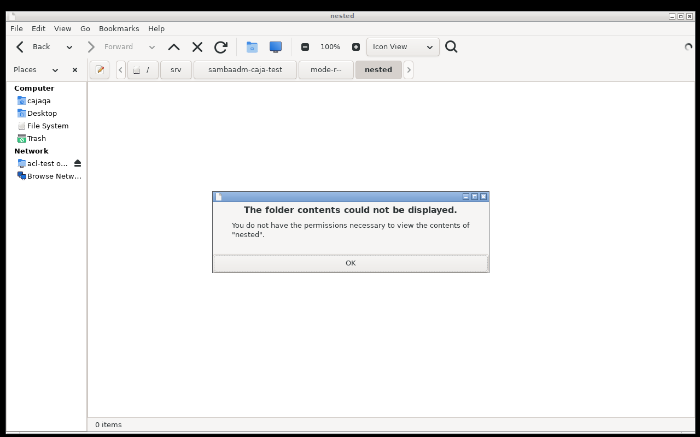
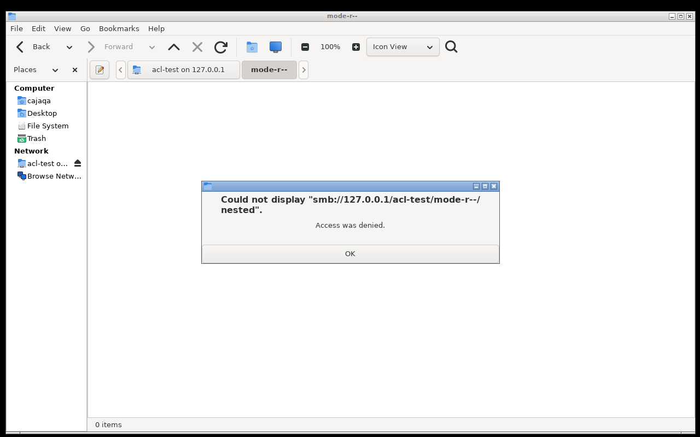
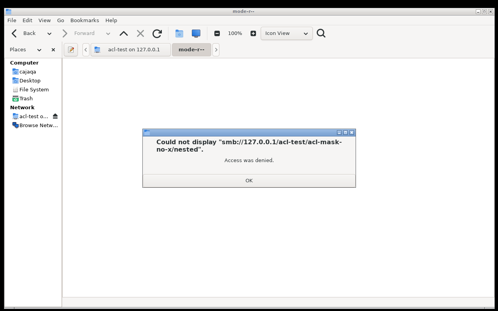
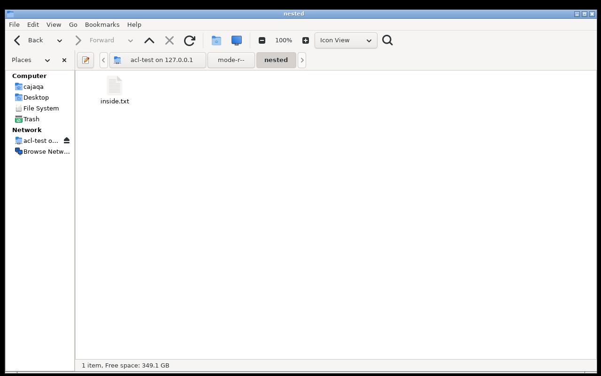
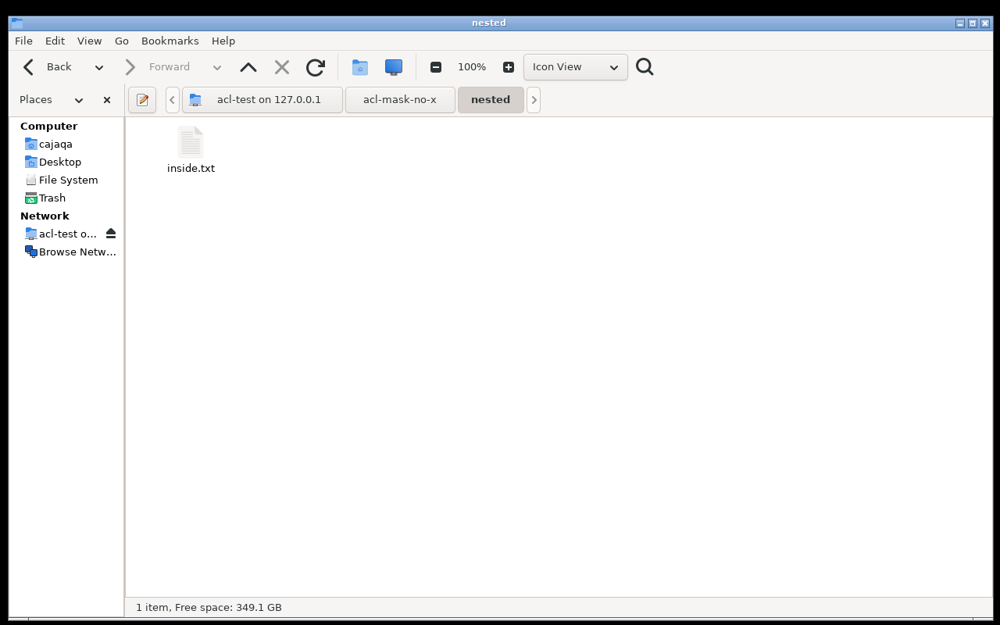

# Проверка права прохода в Caja на ALT p11

Проверено 26 ноября 2026 года. Все проверки завершились успешно.

Использованы настоящие Caja 1.28.1-alt1, GVfs SMB 1.58.5-alt1 и Samba 4.22.11-alt4 на ALT p11/aarch64. GUI запущен в Xvfb внутри изолированного контейнера, от обычного пользователя UID/GID 1000 без capabilities. Проверены локальные пути и SMB через GVfs. Это проверка пакетов ALT p11, а не отдельная проверка полной рабочей станции ALT СП.

## Наблюдаемое поведение

- При `r-x` на родительском каталоге Caja открывает вложенную папку и показывает `inside.txt`; чтение файла успешно локально и через SMB.
- При `r--` на родительском каталоге переход во вложенную папку и чтение файла завершаются отказом.
- Именованная группа с `r-x`, ограниченная ACL-маской `r--`, получает тот же отказ. Наличие `x` в самой записи группы недостаточно.
- Прямое открытие родителя без `x` может показать имена или пустое представление с ошибкой. Видимое окно папки само по себе не доказывает возможность прохода и чтения содержимого.
- Обычный файл с режимом `0644` читается локально и по SMB: ему не требуется право выполнения.

## Применение шаблона через Samba Admin

Интеграционный тест вызвал настоящий сервис приложения: снимок дерева → план → применение шаблона чтения и прохода для группы 1000 ко всему дереву из семи каталогов, с наследуемыми ACL. В двух проблемных каталогах подтверждены `r-x` у группы и маски. После применения Caja успешно открыла те же вложенные каталоги и прочитала файлы локально и по SMB.

Отдельно проверен отказ до изменения прав для каталогов с режимом `0640`, ACL группы без `x`, маской без `x` и наследуемым ACL без `x`. Назначение `0644` обычному файлу разрешено. Полная проверка наследования на доменном Samba-стенде описана в [основном отчёте](../live-samba-validation.md).

## Защита в интерфейсе и сервисе

В редакторе папок выбор чтения или записи автоматически сохраняет проход `x`. Шаблоны используют `r-x` и `rwx`. Ручные режимы и ACL с чтением/записью без прохода отклоняются сервером до операций изменения владельца, режима или ACL; проверка распространяется также на наследуемые ACL и создание каталога ресурса. Для файлов `r--` и `rw-` допустимы. Полный отзыв `---`, проход `--x` и запись с проходом `-wx` остаются допустимыми.

## Скриншоты настоящей Caja

Локальный путь: нет прохода через родителя.

SMB: нет прохода через родителя.

SMB: проход убрала ACL-маска.

Тот же SMB-путь после применения шаблона через приложение.

Папка с исправленной ACL-маской после применения шаблона.

## Доказательства и повторение

[Версии пакетов](versions.txt), [ACL до](before-acl.txt), [ACL после](after-acl.txt), [результат сервиса приложения](template.log), [результаты GUI](results.json).

Повторение: [инструкция стенда](../../../testdata/caja/README.md).
