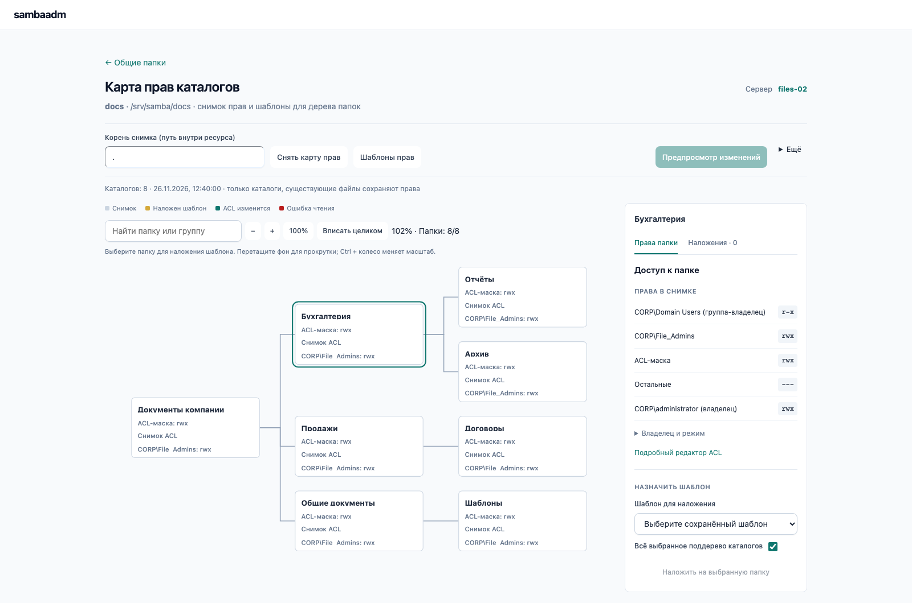
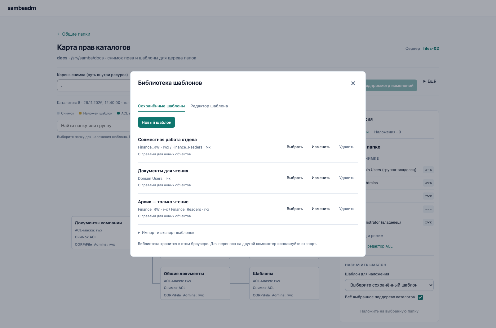
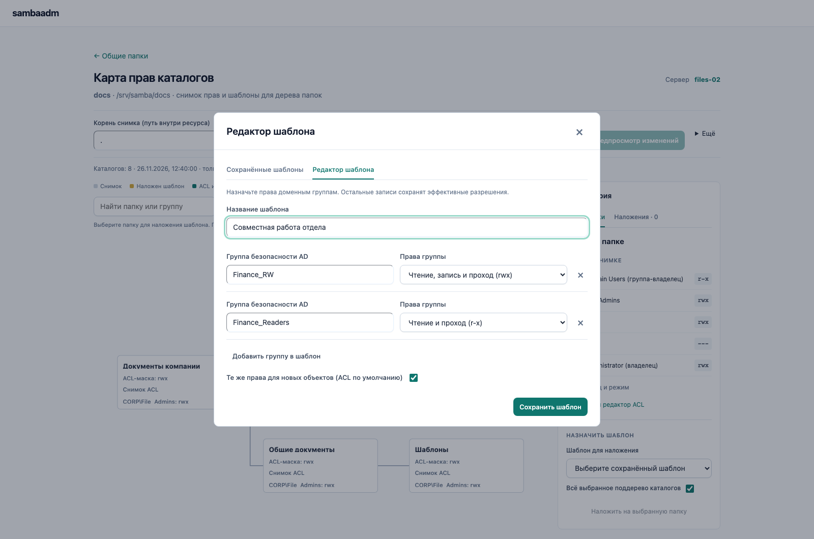
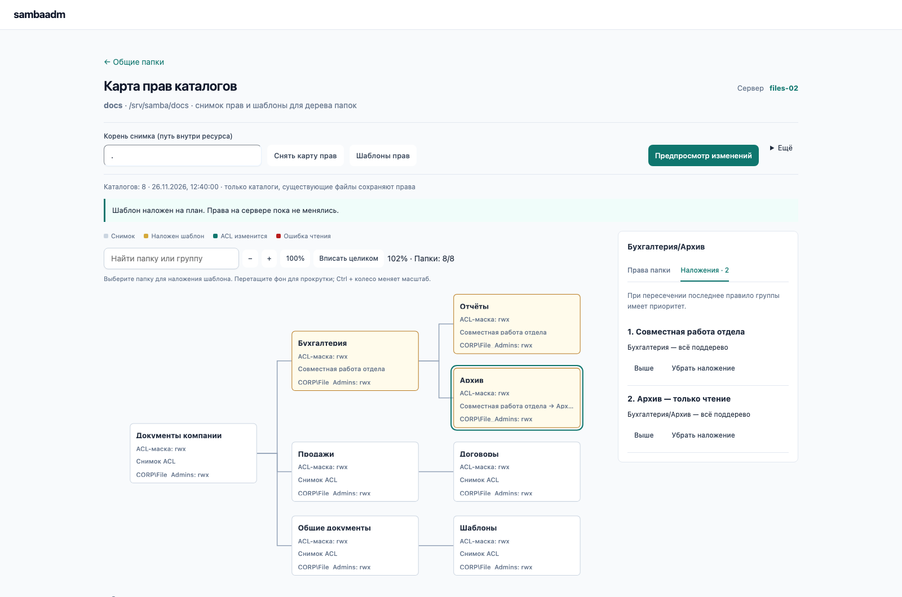
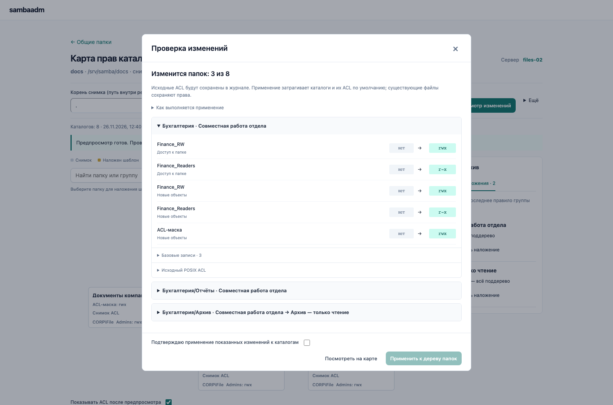
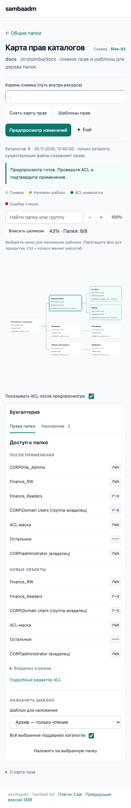
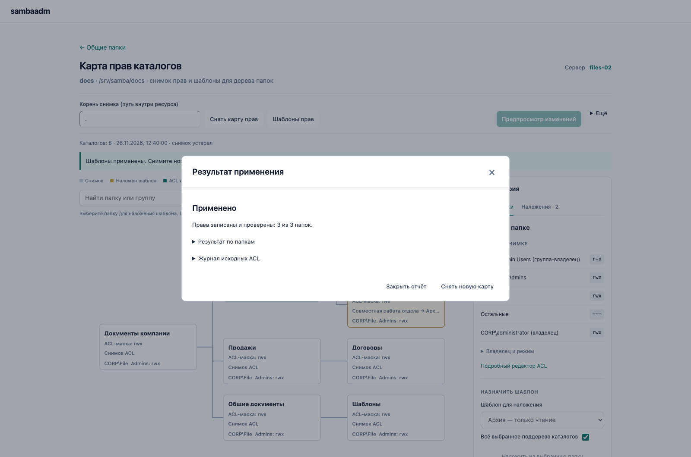

# Карта прав файловых ресурсов: экраны интерфейса

Скриншоты сделаны в браузере с настоящими HTML/CSS/JS sambaadm и демонстрационными ответами API. Дерево, группы и результат применения — тестовые данные; эти действия не меняли права на живом Samba-сервере.

На основном экране находятся карта и свойства одной выбранной папки. Библиотека, создание шаблона и проверка изменений открываются по необходимости в отдельных окнах.

## 1. Снимок дерева и права выбранной папки

Связи папок, группы, ACL-маска и компактная область свойств справа. Перемещение и масштаб работают так же, как на схеме доменных связей.



## 2. Библиотека шаблонов

Сохранённые шаблоны доступны отдельным окном. У каждого видны группы и разрешения; импорт и экспорт раскрываются по необходимости.



## 3. Редактор шаблона

Название, несколько доменных групп с разными разрешениями и настройка прав для новых объектов. Форма не занимает место на карте.



## 4. Наложения на поддеревья

В примере совместная работа назначена ветви «Бухгалтерия», а для «Архив» добавлено более позднее правило чтения. На этом шаге меняется только план.



## 5. Проверка перед применением

Показано, какие папки изменятся и как изменятся права групп. Базовые записи и исходный POSIX ACL доступны по раскрытию. Подтверждение и применение находятся в этом же окне.



## 6. Мобильная ширина

Карта располагается над свойствами папки. Масштаб и поиск доступны в том же интерфейсе.



## 7. Результат применения

Отдельный отчёт показывает число проверенных папок. Подробности по папкам и путь к журналу исходных ACL раскрываются при необходимости.



## Повторное создание скриншотов

Требуются Go, Node.js и Playwright с Chromium:

```sh
node testdata/web/share-permission-map-screenshots.cjs docs/file-resources/assets
```

Сценарий использует тестовую HTML-страницу и подменяет только API. Он не подключается к реальному AD, Samba или helper.
