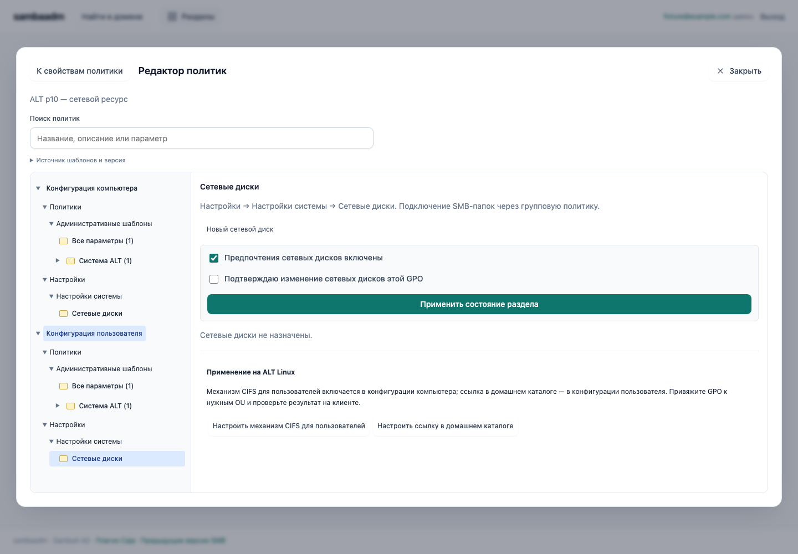
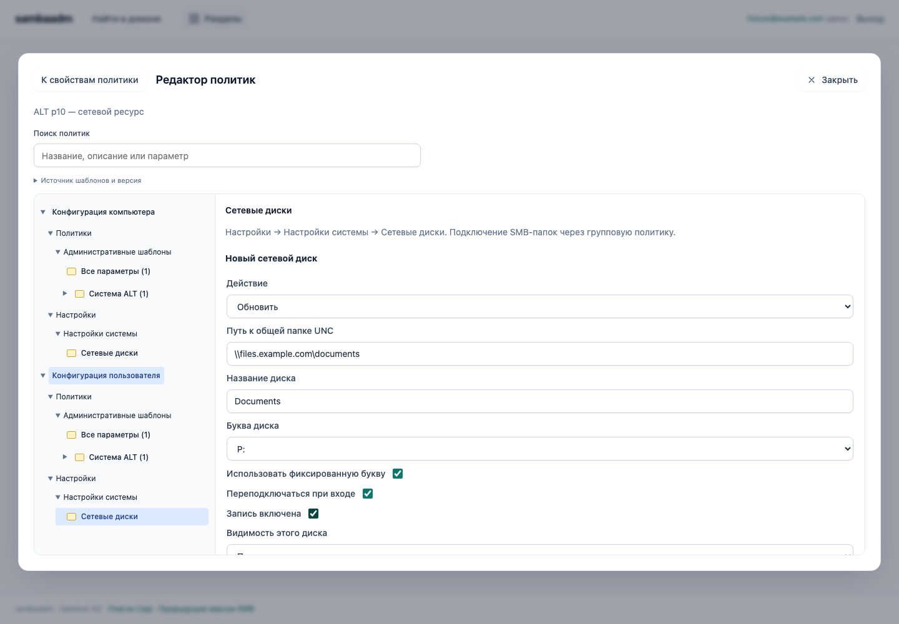
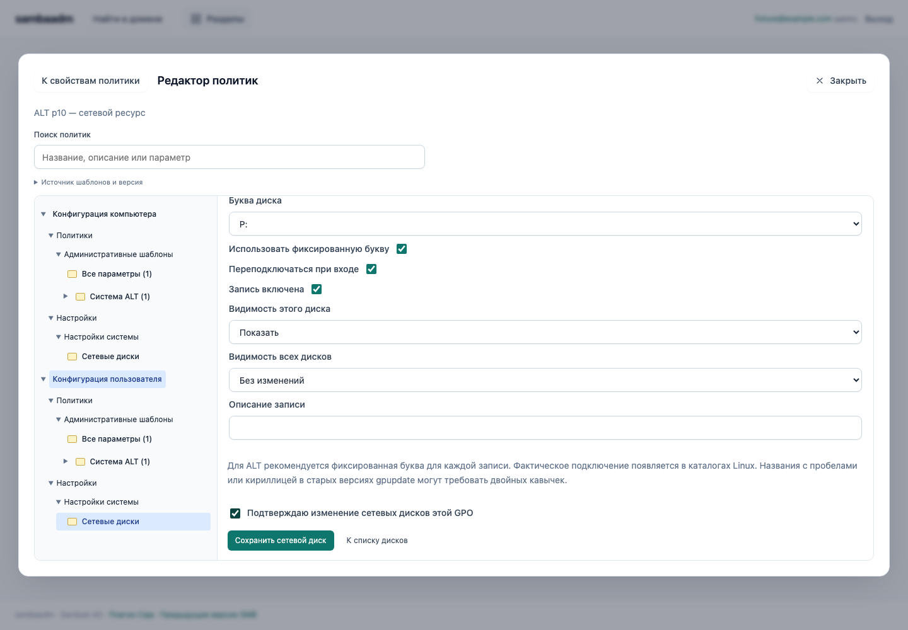
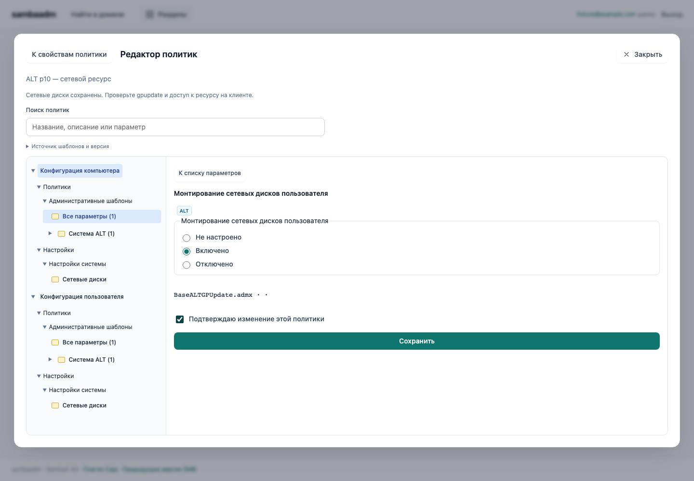
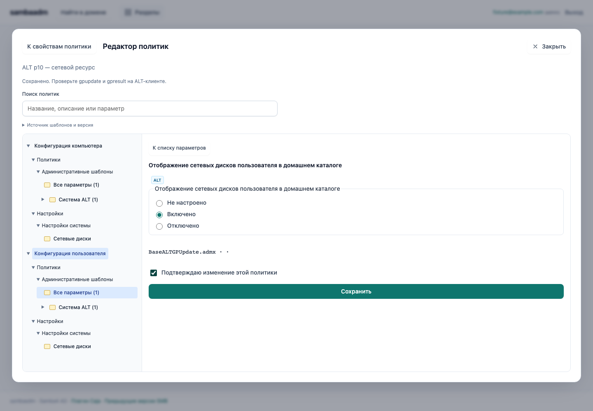
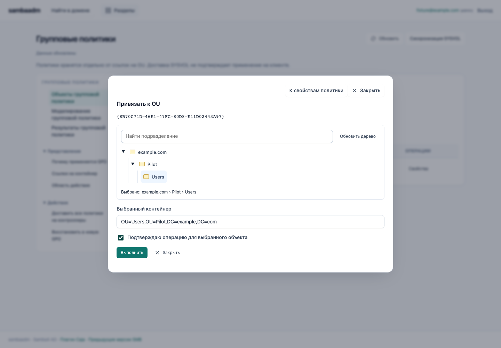

# Подключение сетевой папки через GPO в sambaadm

Инструкция для **ALT Linux p10** и sambaadm 0.54.0. В примере доменный пользователь получает SMB-ресурс `\\files.example.com\documents` и открывает его из каталога `~/net.drives`. Скриншоты сняты в интерфейсе sambaadm с учебными данными. Все настройки политики выполняются в панели.

## 1. Подготовьте ресурс и пилотную группу

- Убедитесь, что файловый сервер доступен со станции по полному DNS-имени и что пилотная доменная учётная запись может открыть ресурс. Для предварительной проверки в файловом менеджере можно ввести `smb://files.example.com/documents`. Права на SMB-ресурс и его каталог задаются на файловом сервере.
- Проверьте, что станция введена в домен и на ней включено применение групповых политик ALT. Команды `rpm -q gpupdate` и `control system-policy` показывают установленный пакет и выбранный механизм. Ожидаемое значение второй команды — `gpupdate`. Если механизм ещё не включён, администратор станции может выполнить `gpupdate-setup enable` от root. [Документация ALT p10 по gpupdate](https://docs.altlinux.org/ru-RU/domain/10.4/html/alt-domain-p10/gpupdate.html).
- Определите OU пилотных пользователей и OU пилотных компьютеров. В примере это `Pilot → Users` и `Pilot → Workstations`.

## 2. Назначьте сетевой диск пользователю

1. Откройте **Групповые политики → Создать GPO**. Назовите политику, например **ALT p10 — сетевой ресурс**.
2. В строке новой GPO откройте **Свойства → Редактор политик**. В левом дереве выберите **Конфигурация пользователя → Настройки → Настройки системы → Сетевые диски**. Нажмите **Новый сетевой диск**.



3. Выберите действие **Обновить**, введите полный UNC-путь `\\files.example.com\documents` и название **Documents**. Выберите свободную букву **P:** и оставьте **Использовать фиксированную букву**, **Переподключаться при входе** и **Запись включена**. Для поля **Видимость этого диска** выберите **Показать**. На ALT буква служит идентификатором записи, а ресурс открывается как каталог.



4. Внизу формы отметьте **Подтверждаю изменение сетевых дисков этой GPO** и нажмите **Сохранить сетевой диск**. Проверьте, что запись **Documents** появилась в списке со статусом **Включена**.



## 3. Включите CIFS и ссылку в домашнем каталоге

В списке сетевых дисков под таблицей есть раздел **Применение на ALT Linux** с двумя кнопками.

1. Нажмите **Настроить механизм CIFS для пользователей**. Панель откроет параметр `CIFSApplierUser` в **Конфигурации компьютера**. Выберите **Включено**, отметьте подтверждение и нажмите **Сохранить**.

   

2. Вернитесь через левое дерево в пользовательские **Сетевые диски**. Нажмите **Настроить ссылку в домашнем каталоге**. В параметре `DriveMapsHomeUser` выберите **Включено**, отметьте подтверждение и сохраните.

   

Если панель сообщает, что шаблон параметра недоступен, откройте **Настройки → Локальные шаблоны политик → Импортировать / обновить шаблоны**. Убедитесь, что источник шаблонов содержит ADMX и соответствующие ADML для ALT. После импорта снова откройте редактор GPO.

## 4. Привяжите политику к двум OU и проверьте SYSVOL

В **Свойствах** этой GPO нажмите **Привязать к OU**. Выберите в дереве OU пилотных пользователей, проверьте поле **Выбранный контейнер**, отметьте подтверждение и нажмите **Выполнить**. Повторите для OU пилотных компьютеров. Первая привязка назначает ресурс пользователям, вторая включает механизм монтирования на их компьютерах. Если обе учётные записи уже находятся в области одной подходящей привязки, её достаточно.



Убедитесь, что обе части GPO включены, а компьютер и пользователь могут читать и применять политику. В домене с несколькими DC проверьте **Согласованность SYSVOL** в свойствах GPO. Если политика сохранена на одном Samba DC, а клиент обращается к другому, воспользуйтесь **Доставить на контроллеры** для этой GPO и проверьте результат доставки на нужный DC.

## 5. Проверьте подключение на ALT p10

На пилотной станции проверьте наличие утилиты командой `rpm -q gpresult`. Если её нет, установите пакет `gpresult` из репозитория p10. Затем обновите компьютерную часть от root.

```sh
gpupdate --target Computer --force
```

Войдите в графическую сессию пилотным доменным пользователем и выполните команды от его имени.

```sh
gpupdate --target User --force
gpresult -v -u -n 'ALT p10 — сетевой ресурс'
readlink -f "$HOME/net.drives"
```

В отчёте `gpresult` найдите пользовательскую GPO и заданный UNC-путь. Затем откройте **net.drives** в домашнем каталоге, зайдите внутрь сетевой папки и откройте известный файл. Это проверяет доступ к содержимому, поскольку каталог может появиться до фактического монтирования. При стандартных настройках ссылка ведёт в `/run/media/<пользователь>/drives`. [Руководство ALT p10 по сетевым дискам](https://docs.altlinux.org/ru-RU/domain/10.4/html/alt-domain-p10/drives.html) · [Справка по gpresult](https://docs.altlinux.org/ru-RU/domain/10.4/html/alt-domain-p10/gpresult.html).

- **Политики нет в отчёте.** Проверьте OU, фильтрацию безопасности и состояние частей GPO. Запустите `gpresult -v -m` для проверки компьютерной части. При нескольких DC сверяйте версии и состояние SYSVOL.
- **Политика есть, но ссылки нет.** Проверьте оба параметра из шага 3 и повторите вход доменного пользователя. Логи применения можно посмотреть командами `journalctl -u gpupdate.service -b` от администратора и `journalctl --user -u gpupdate-user.service -b` из пользовательской сессии.
- **Папка видна, но не открывается.** Проверьте DNS-имя, доступ к серверу по SMB и права пользователя на ресурс и каталог.

Чтобы снять уже назначенное подключение, откройте ту же запись, установите **Удалить подключение** и дождитесь применения на клиентах. Затем можно удалить запись из GPO.
