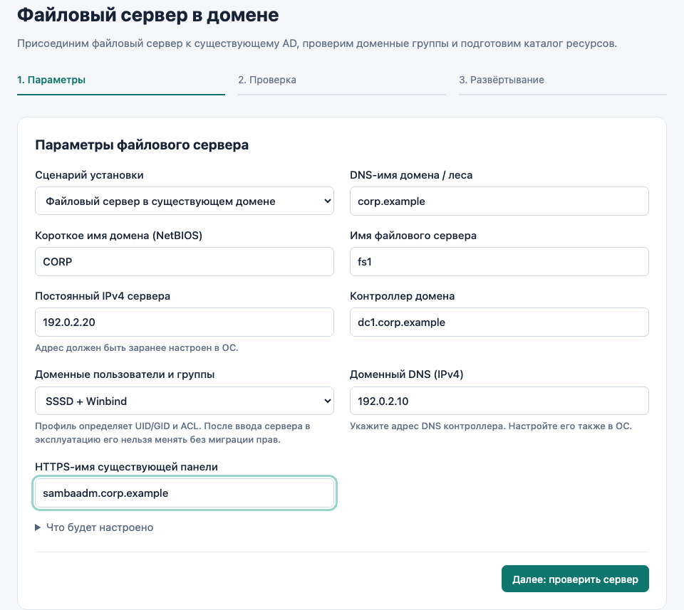
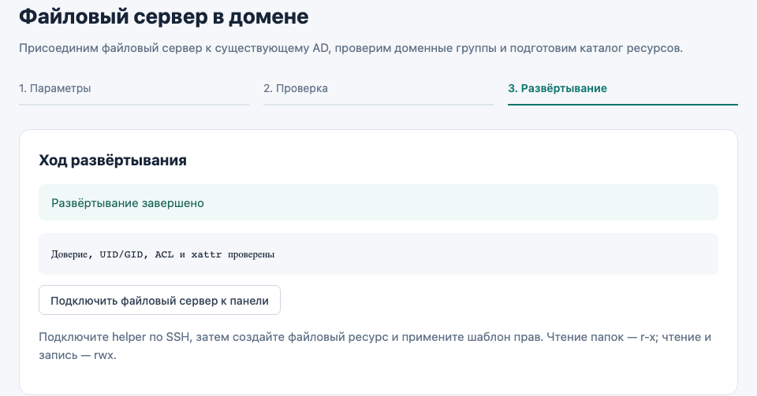

# Установка контроллера домена или файлового сервера

После установки RPM запустите на новом сервере ALT Linux:

```sh
sudo samba-server-init
```

Мастер использует временный HTTPS на TCP/8445, код из консоли, проверку отпечатка сертификата и три шага: параметры → проверка → развёртывание. Команда `samba-domain-init` сохранена для совместимости и открывает тот же мастер. Установка обновлений RPM не запускает развёртывание.

В поле «Сценарий установки» доступны новый лес, первый Samba RWDC существующего домена и файловый сервер существующего домена. Дополнительные RWDC/RODC по-прежнему развёртываются из рабочей панели. [Установка контроллеров](domain-init.md).

## Файловый сервер

Подготовьте чистый отдельный сервер с постоянным IPv4, доменным DNS и синхронизацией времени. Нужны существующий AD, доступ к DC по DNS/Kerberos/LDAP/SMB, существующая HTTPS-панель Samba Admin и доменная запись с правом присоединения компьютера. Установка не создаёт новый домен и не переносит FSMO.

Укажите домен, его NetBIOS, свободное короткое имя файлового сервера, IPv4, FQDN контроллера, доменный DNS и HTTPS-имя существующей панели. Выберите один из двух профилей:

- **Winbind:** NSS и Samba используют Winbind; основной домен сопоставляется через `idmap_rid`, диапазон 1000000–1999999.
- **SSSD + Winbind:** NSS использует SSSD, Samba — Winbind с `idmap_sss`. Диапазон SSSD 200000–2000200000, размер среза 200000; Winbind получает те же идентификаторы из SSSD. На Samba 4.21+ смену машинного пароля выполняет Winbind с синхронизацией keytab. На Samba 4.19 в p10 ротацию выполняет SSSD/adcli с `ad_update_samba_machine_account_password = True`, обновляя также Samba `secrets.tdb`; самостоятельная ротация Winbind отключена.

Для BUILTIN используется отдельный записываемый `tdb` с диапазоном 10000–199999. Профили не обязаны выдавать одинаковые UID/GID между собой. Мастер предназначен для первичного основного домена; дополнительные доверенные домены автоматически не настраиваются.



При проверке мастер проверяет ОС, systemd, назначенный адрес, доступность DC, репозитории, пакеты и совместимый комплект helper. Перед применением повторяет проверку и сверяет версию плана. Сначала скачиваются все пакеты, затем выполняются установка, резервное копирование конфигурации и присоединение.

Перед присоединением защищённый LDAP-запрос проверяет домен, его NetBIOS и отсутствие компьютера с выбранным именем. Пароль передаётся через stdin, не сохраняется в журнале и не помещается в аргументы процесса. При сбое доменные данные не удаляются автоматически; резервные копии остаются в закрытом каталоге задания. После частичного присоединения повторное развёртывание блокируется: сначала проверьте журнал и состояние сервера.

Существующие базы Samba/SSSD, keytab, настроенный NSS, изменённый smb.conf и непустой `/srv/samba` не заменяются. Для действующего файлового сервера смена SSSD/Winbind требует отдельной миграции владельцев и ACL.

После присоединения мастер проверяет доверие, прямое и обратное сопоставление SID ↔ UID/GID, одинаковые идентификаторы NSS и Samba, поддержку POSIX ACL и xattr. Каталог `/srv/samba` получает `0755`. Папки ресурсов используют маску `0770`, файлы — `0660`; папкам нужен проход `x`, обычным файлам выполнение не добавляется.

SSSD запускается перед Winbind в соответствующем профиле, Samba SMB — после служб идентификации. Доменные SSH-входы и публичные ресурсы мастер не включает.

## Подключение к панели

На последнем экране откройте «Подключить файловый сервер к панели». В существующей панели подтвердите SSH-ключ, укажите SSH-доступ и завершите регистрацию helper. Комплект helper той же версии уже установлен. Роль Samba определяется на сервере: для участника домена LDAP направляется на DC из настроек панели, для контроллера сохраняется локальный LDAP.



После регистрации выберите файловый сервер в разделе файловых ресурсов, создайте ресурс, снимите карту каталогов и примените шаблоны прав. Для чтения папок используйте `r-x`, для чтения и записи — `rwx`; маска и наследуемые права должны сохранять `x`. [Проверка в Caja](file-resources/caja-alt-p11/README.md).

## Проверки

26 ноября 2026 года оба профиля проверены на настоящем Samba AD в одноразовом стенде: ALT p11/aarch64 с Samba 4.22.11-alt4 и SSSD 2.9.9-alt1, а также ALT p10/aarch64 с Samba 4.19.9-alt12 и SSSD 2.9.7-alt1.p10.1. Подтверждены присоединение через Kerberos, согласованные NSS/Samba UID/GID, отказ повторного использования занятого имени, подписанная SMB-запись/чтение, отсутствие `x` у нового файла и наследование `r-x` у вложенной папки. Для SSSD дополнительно сменён машинный пароль и проверен Kerberos-вход по обновлённому keytab.

[p11 Winbind — журнал](server-init-guide/winbind.log), [p11 SSSD + Winbind — журнал](server-init-guide/sssd.log), [p10 Winbind — журнал](server-init-guide/p10-winbind.log), [p10 SSSD + Winbind — журнал](server-init-guide/p10-sssd.log). Повторение: `ALT_BRANCH=p10 testdata/member/run.sh /tmp/sambaadm-member-p10-results` и аналогично с `ALT_BRANCH=p11`. Это реальная проверка AD, служб и SMB в контейнерах; полный мастер на отдельной физической машине ALT СП и её systemd этим сценарием не проверяется.

Автоматические проверки также охватывают валидацию, отказ при устаревшем плане и недоступных пакетах, секреты только на stdin, оба варианта UI, перезагрузку страницы без повторного присоединения, мобильный экран и прежние сценарии контроллеров.

Использованы [документация ALT о файловом сервере](https://docs.altlinux.org/ru-RU/alt-domain/11.1/html/alt-domain/samba-fileserver.html), [idmap_sss SSSD](https://github.com/SSSD/sssd/blob/master/src/man/idmap_sss.8.xml) и [документация Samba о keytab](https://www.samba.org/samba/docs/current/man-html/net.8.html). Совместимость конкретного синтаксиса keytab проверена настоящим `testparm` и ротацией на ALT p11.
