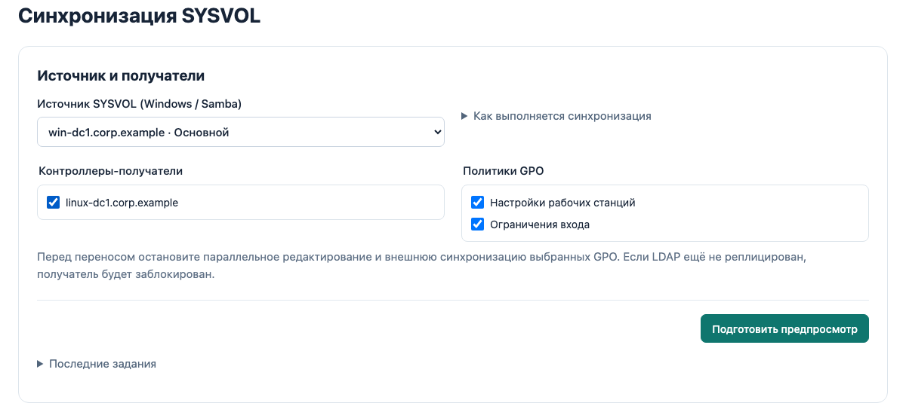
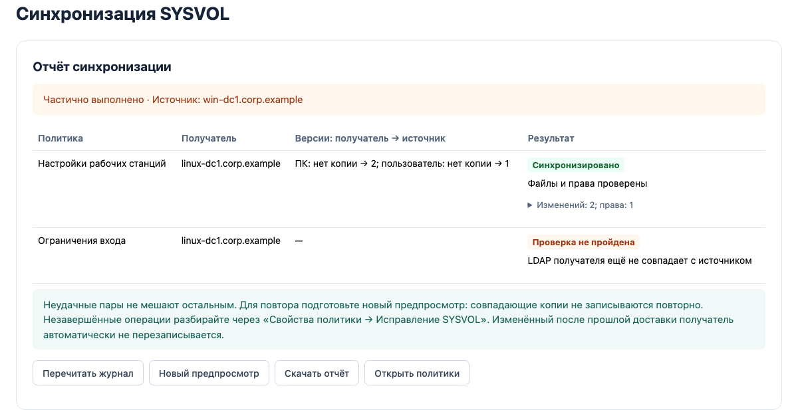

# Синхронизация политик SYSVOL с Windows DC

В sambaadm 0.54.0 откройте **Групповые политики → Синхронизация SYSVOL**. Выберите исходный Windows или Samba RWDC, политики и контроллеры-получатели с зарегистрированными helper. Перенос выполняется по запросу администратора; постоянная DFSR-служба и автоматический запуск по расписанию не настраиваются.

Настоящий Windows DC пока не предоставлен для проверки. Чтение без helper на источнике через SMB/Kerberos, сохранение прав, повторные запуски и конфликты проверяются на изолированном Samba AD. Для рабочего Windows AD сначала выполните пилот со своими GPO, ACL и клиентами.

Иллюстрации показывают настоящий интерфейс на учебных именах `corp.example`; это не отчёт испытаний Windows.

## Подготовка

- Источник должен быть обнаруженным записываемым DC текущего домена. Helper на Windows не нужен: приложение читает его SYSVOL напрямую, используя **Kerberos и подпись SMB**, без перехода на NTLM.
- Служебная запись панели должна принадлежать текущему домену и иметь права читать LDAP, файлы SYSVOL, владельцев, группы и DACL. Для Kerberos используйте основной UPN домена или `NETBIOS\логин`. Ключ HTTP для входа пользователей в панель не заменяет эти служебные полномочия.
- Обеспечьте доменный DNS, точное время, доступ к KDC TCP/UDP 88, SMB TCP 445 и защищённому LDAP исходного DC и получателей. Для LDAPS Windows настройте серверный сертификат и добавьте его УЦ в доверенный комплект `ldap.ca_cert` панели. Проверка сертификатов не отключается.
- Обновите панель и helper до 0.54.0 или новее. На каждом получателе нужен подключённый helper и уже инициализированный каталог `SYSVOL/<домен>/Policies`. При первичном развёртывании это делает мастер sambaadm. Отсутствующий родительский каталог не создаётся автоматически без проверки его прав.
- Сначала дождитесь репликации объектов GPO и их прав через AD. Эта страница не меняет LDAP и не подменяет версии для обхода расхождений.
- На время переноса остановите параллельное редактирование выбранных GPO и внешнюю синхронизацию SYSVOL. Переключение каталога GPO имеет короткий промежуток недоступности.

## Предпросмотр

1. Выберите исходный DC. Он становится явно выбранной административной копией, а не автоматически определённым «самым правильным» сервером.
2. Отметьте получателей и политики. Источник нельзя одновременно выбрать получателем. За один запуск допускается до 16 получателей и 256 пар GPO/DC; большие объёмы разделите на задания.
3. Нажмите **Подготовить предпросмотр**. Страницу можно закрыть: подготовка продолжается, последнее задание восстанавливается после перезагрузки браузера.
4. Проверьте результат отдельно для каждой пары: версию компьютерной и пользовательской частей, перечень изменений файлов и путей с изменёнными правами.
5. Подтвердите выбранный источник, получателей, изменения и окно обслуживания. Кнопка **Синхронизировать готовые пары GPO/DC** применяет только готовые пары. Заблокированные пары не мешают остальным.

Проверяются LDAP-метаданные и права объекта GPO, версия `GPT.INI`, SHA-256 содержимого, владельцы, группы и DACL файлов и каталогов. Обе 16-битные части версии сравниваются раздельно. Более новая версия получателя не понижается; повреждённая или неизвестная версия требует отдельного восстановления GPO.

Для обращений к helper сохраняется выбранный режим авторизации. Если используется учётная запись текущего сеанса, фоновая операция обращается к отзывному провайдеру сессии; выход пользователя или истечение сеанса прекращают последующие обращения. Пароль в файл задания не копируется. Получатели используют Kerberos для доступа к собственному SYSVOL.

## Перенос и защита изменений

Перед записью источник и получатель перечитываются, а результат сравнивается с предпросмотром. Если изменились файлы, ACL, LDAP или версия, старый план не применяется. Источник дополнительно проверяется во время переключения каталога.

Получатель сначала получает отдельный проверяемый каталог. Исходная папка и защищённые снимки сохраняются механизмом **Исправление SYSVOL**; после переключения проверяются содержимое и права. Незавершённая операция не объявляется успешной и не повторяется автоматически.

После успешной доставки приложение сохраняет контрольную подпись получателя. Если до следующего предпросмотра его изменили отдельно, такой получатель блокируется. Разберите изменения в свойствах GPO: сравните копии, при необходимости выполните явное восстановление с нужного источника. Повторное создание плана само по себе не разрешает затереть локальные изменения.

## Повтор, частичный сбой и журнал

Для каждой пары отображается результат: **Совпадает**, **Синхронизировано**, **Проверка не пройдена**, **Конфликт изменений** или ошибка. Готовые пары обрабатываются независимо; недоступный получатель не отменяет доставку остальным.

После исправления доступности DC, LDAP или прав нажмите **Новый предпросмотр**. Уже совпадающие копии проверяются, но не записываются повторно. Прежний план нельзя применить второй раз. При потере ответа используйте **Перечитать журнал**, чтобы узнать результат исходного задания.

Если указан номер восстановления или процесс был прерван, откройте **Свойства политики → Исправление SYSVOL**. Сначала завершите или откатите незавершённую транзакцию по её журналу. Новый перенос не обходит такую блокировку. После перезапуска приложения задания в работе получают статус **Прервано**; доставка автоматически не возобновляется.

Последние 30 заданий доступны на странице; каждое можно открыть по сохранённому идентификатору и выгрузить как JSON. История хранится в закрытом подкаталоге `sysvol-sync` каталога `gpo.delegation_state_dir`, файлы имеют права 0600. Пароли и Kerberos-билеты в журнал не записываются. Операции отражаются также в аудите приложения.

## Границы переноса

Переносятся существующие деревья `Policies/{GUID}`, включая внутренние сценарии GPO. Внутри выбранного дерева учитываются добавление, изменение и удаление файлов. Объекты и ссылки GPO в AD не создаются, не удаляются и не изменяются этой операцией. Осиротевшие папки удалённой GPO автоматически не очищаются.

Отдельный NETLOGON, центральное хранилище ADMX/ADML, SACL, альтернативные потоки и произвольные расширенные атрибуты не входят в этот формат. Переносятся и проверяются обычные файлы, каталоги, владельцы, группы и DACL. Приложение не включает Windows–Samba DFSR и не пишет на выбранный источник.

Правила версий основаны на [Microsoft — версия файловой части GPO](https://learn.microsoft.com/en-us/openspecs/windows_protocols/ms-gpol/59bb540a-64f4-4c52-9c55-5ca2fd2c0270) и [Microsoft — LDAP и GPT.INI](https://learn.microsoft.com/en-us/openspecs/windows_protocols/ms-gpod/d360d288-d7d5-49a9-83be-603805da1379). После переноса проверьте фактическое применение политик на тестовых Windows и ALT клиентах; совпадение копий не заменяет эту проверку.
