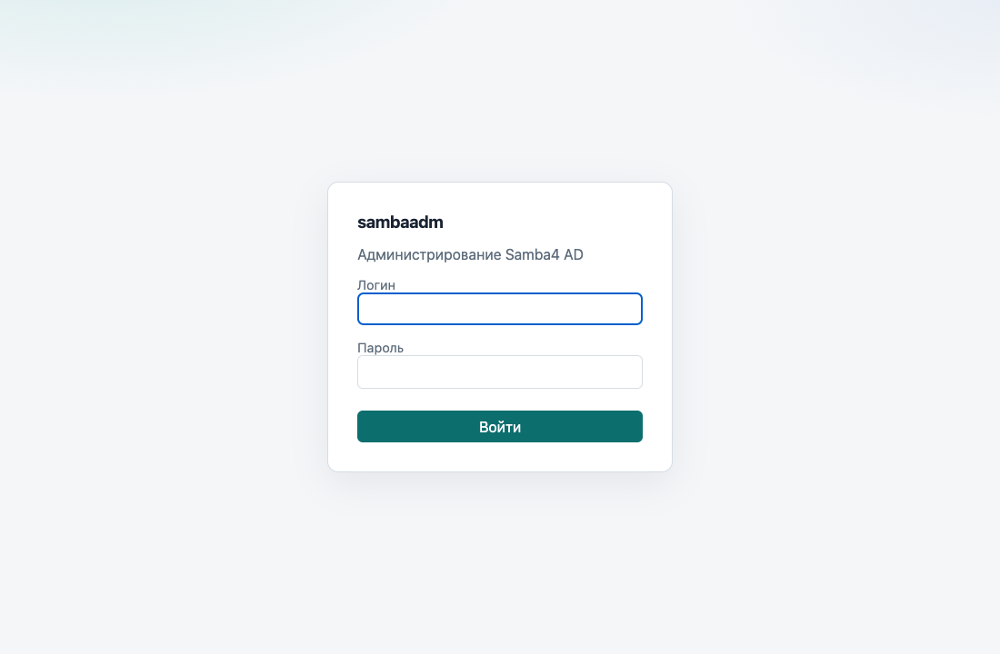
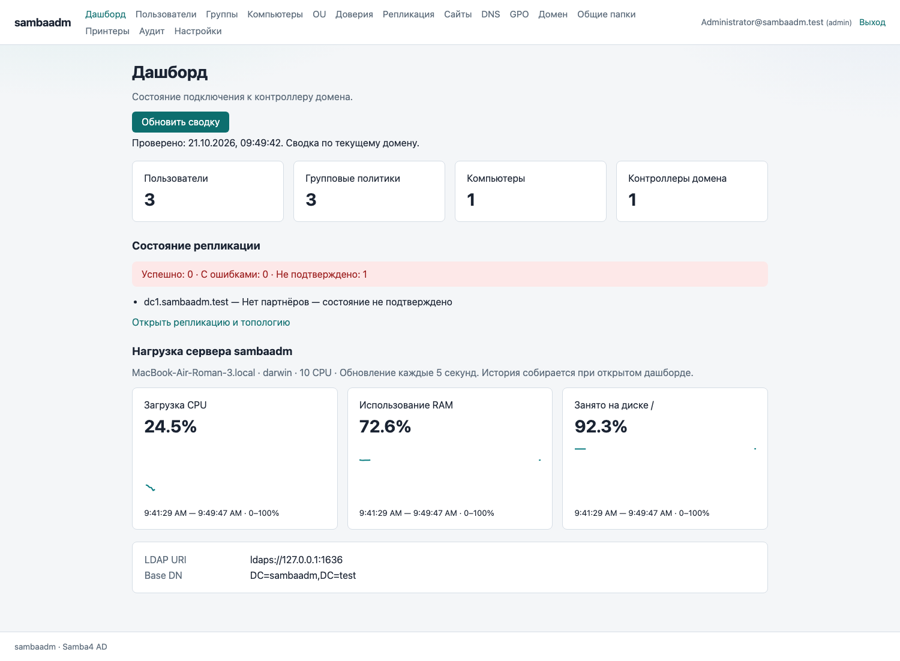
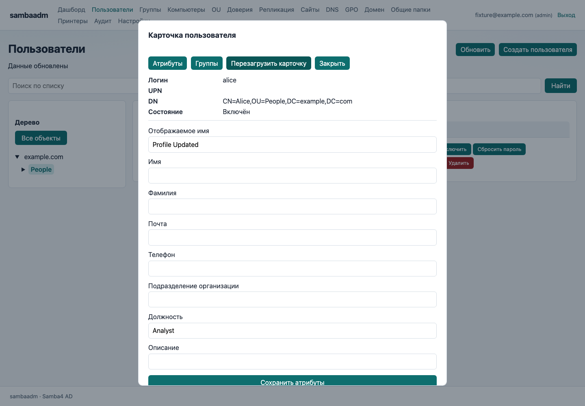
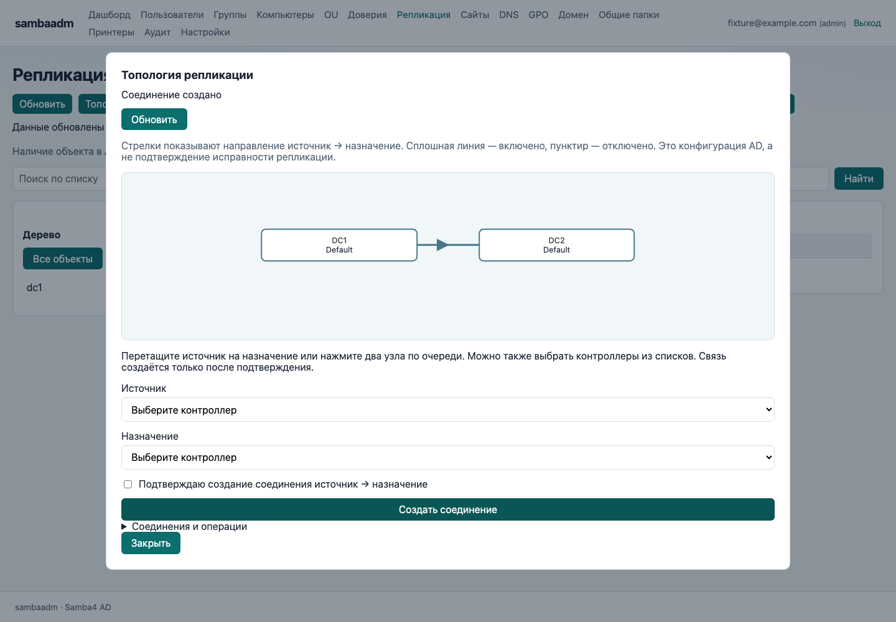

# Руководство пользователя sambaadm

Версия 0.34.0 от 4 ноября 2026 года. Это инструкция оператора веб-интерфейса с ролью readonly или helpdesk. Самостоятельная настройка сервера и изменения домена выполняются администратором. Приложение не является порталом самообслуживания сотрудников.

[Инструкция Word с иллюстрациями](user-guide/sambaadm-user-guide.docx). [Руководство администратора](admin.md). Инструкция администратора описывает установку, helper, политики и управление RODC. Иллюстрации содержат учебные данные.

## Вход и завершение работы

1. Получите у администратора адрес сайта и право доступа. Открывайте именно выданный адрес, а не localhost чужого компьютера.
2. Введите доменное имя пользователя, например ivanov@example.com, и пароль этой записи.
3. После входа проверьте роль и нужный домен. Встроенного логина и стандартного пароля нет.
4. Закончив работу, нажмите «Выйти». На общем компьютере не оставляйте сессию открытой.

Readonly позволяет читать сведения. Helpdesk дополнительно включает и отключает пользователей и сбрасывает пароли. Остальные изменения требуют admin. Отсутствующая кнопка может означать недостаточные права, а не неисправность. Даже видимая операция может быть отклонена правами домена.

Если сессия закончилась или сервер перезапущен, войдите снова. При смене роли также нужен новый вход. Не передавайте свой пароль в сообщениях поддержки и не вводите его на странице с неожиданным адресом.

## Главная страница и состояние системы

На главной странице видны количество пользователей, политик, компьютеров и контроллеров. Контроллеры входят в общее число компьютеров. Нажмите «Обновить сводку», если нужны свежие данные.

«Недоступно» означает ошибку запроса, а не нулевое количество. Отсутствие партнёров репликации не означает подтверждённое исправное состояние. Сообщите администратору об ошибках с указанием времени и контроллера.

Графики показывают CPU, RAM и занятое место на системном диске сервера, выбранного администратором как helper host_node. Это может быть удалённый файловый сервер или контроллер; остальные DC здесь не измеряются. Заполнение диска не является скоростью дисковых операций.

Данные обновляются каждые 5 секунд в открытой вкладке. История ограничена 120 замерами и сбрасывается при перезапуске приложения. Первый замер CPU может отсутствовать. Разрыв линии или «Нет замера» означает отсутствие данных, а не нулевую нагрузку.

## Поиск пользователей и просмотр карточки

1. Откройте «Пользователи» и нажмите «Обновить».
2. Раскройте дерево слева и выберите контейнер или OU. Для поиска по всему загруженному списку выберите «Все объекты».
3. Введите имя или логин в поиск. Если запись не найдена, проверьте выбранную ветвь и обновите список.
4. Откройте «Свойства», сверьте логин, UPN и DN. Одинаковые отображаемые имена не гарантируют, что это одна запись.
5. На вкладке «Группы» посмотрите прямое членство и основную группу.

Readonly и helpdesk просматривают атрибуты, но не редактируют профиль и членство. Основная группа помечена отдельно; вложенные группы здесь не разворачиваются. Для изменения почты, должности, OU или групп передайте администратору логин и нужное изменение.

Аналогичное дерево есть в разделах групп, компьютеров и OU. Выбор подразделения включает вложенные объекты. Текстовое «Подразделение организации» в карточке не является адресом OU.

## Операции службы поддержки

Эти действия доступны helpdesk и admin. Перед сбросом пароля или изменением состояния подтвердите личность заявителя по процедуре своей организации и сверьте точную учётную запись.

1. Найдите пользователя и откройте карточку либо действия в строке.
2. Для временного прекращения доступа выберите «Отключить», проверьте логин и подтвердите операцию. Для возврата доступа используйте «Включить».
3. Для смены пароля выберите «Сбросить пароль», дважды введите новый пароль, соответствующий требованиям домена, и подтвердите.
4. Дождитесь успешного результата и перечитайте состояние записи. Сообщите пользователю результат по принятому защищённому каналу.

Пароль после успешной операции очищается из формы. Не включайте его в скриншоты, заявки и журнал переписки. Сообщение о несоответствии политике домена требует другого пароля, а не многократного повторения той же операции.

Helpdesk не создаёт и не удаляет записи, не меняет группы, атрибуты и OU. Если действие недоступно, обратитесь к администратору. Отключение записи не следует считать доказательством немедленного завершения всех уже открытых пользовательских сеансов.

Если операция завершилась ошибкой, сохраните текст без секретов и время. При сомнении сначала перечитайте состояние, чтобы не повторить уже выполненное изменение.

## Просмотр DNS политик и топологии

В DNS раскройте зону и «Имена записей», выберите имя и нажмите «Показать». Если дерево не загрузилось, это может быть ограничение чтения каталога. Передайте администратору зону, имя, ожидаемое значение и текст ошибки.

В GPO выберите политику и откройте свойства или «Параметры ALT». Параметры организованы в дерево шаблонов и категорий; используйте поиск и разделы Machine/User. Просмотр настройки не подтверждает её применение на компьютере.

«Область действия» показывает ссылки домена/OU, порядок, отключённые ссылки и наследование. Это структурный предпросмотр, а не результирующая политика конкретного пользователя. «Фильтрация безопасности» показывает права; изменение доступно администратору.

В «Сайты» и «Репликация» кнопка «Топология» открывает карту. Сплошные стрелки означают включённые соединения, пунктирные — отключённые. Readonly и helpdesk не создают соединения перетаскиванием. Для оценки исправности откройте состояние репликации и смотрите ошибки, партнёра, раздел и последний успех.

### Моделирование результирующей политики ALT и Windows

В разделе GPO нажмите «Моделирование политики». Выберите пользователя или компьютер либо домен/OU. Можно указать условное перемещение в другую OU и режим loopback None, Merge или Replace. Объекты и политики при этом не изменяются; расчёт доступен всем ролям.

Безопасность и WMI задаются как допущения для всех GPO или отдельно по политике. По умолчанию они неизвестны: отчёт будет неполным. Разрешение включает также чтение GPO/SYSVOL; приложение не выполняет проверку ACL или WMI на клиенте. При сомнении согласуйте допущения с администратором.

Нажмите «Рассчитать результат». Для ALT показаны итоговые состояния, значения и GPO-источники параметров ADMX/ADML. Разные значения одного параметра реестра выделены цветом и подписью «Конфликт»: ниже видны конкуренты и победившая GPO. Одинаковые значения не считаются конфликтом. Подробности доступны в списке Registry.pol.

Скачайте отчёт JSON, чтобы передать сценарий администратору. При изменении сценария расчёт нужно повторить. Неизвестные условия, ошибки и неподдерживаемые директивы могут изменить значения и победителей. Модель не охватывает сайты, локальные политики и все клиентские расширения; фактическое применение проверяется на ALT/Windows-клиенте.

## Общие папки и обращение за помощью

В разделе «Общие папки» можно просмотреть публикации и доступные сведения о правах. Создание, изменение и удаление выполняет администратор. Веб-список не является файловым менеджером: для работы с документами используйте SMB-путь, выданный администратором, например \\fileserver\Finance.

Публикации, метрики и принтеры относятся к управляемому серверу helper host_node, выбранному администратором. Компьютер с браузером или веб-приложением может быть другой машиной. Ошибка helper означает недоступность источника данных или файлового действия; она не подтверждает удаление папки.

При обращении в поддержку укажите адрес сайта, время, раздел, действие, логин или DN объекта и точный текст ошибки. Приложите скриншот без пароля и лишних персональных данных. Для репликации укажите DC и раздел, для GPO — имя и GUID, для папки — сервер и имя публикации.

- Страница не открывается: проверьте выданный адрес, сеть и VPN; сообщите администратору.
- Неверный вход: проверьте UPN, раскладку и пароль домена. Не используйте локальную запись компьютера вместо доменной.
- 401: войдите заново. 403: сообщите о нехватке прав; повторный вход нужен после изменения роли.
- 409: объект изменился. Перечитайте данные и согласуйте повторную операцию.
- Данные отсутствуют: снимите фильтр дерева и поиска, обновите список. Ошибка запроса не равна пустому домену.

Не меняйте чужую запись для проверки интерфейса. Если нужна пробная операция, попросите администратора выделить тестовую учётную запись и согласовать проверку.

## Работа с политиками без изменения домена

В карточке GPO можно читать параметры, ссылки и права в пределах своей роли. Кнопка «Сценарии» показывает команды запуска, завершения работы, входа и выхода и позволяет скачать доступный файл. Скачивание не запускает сценарий. Отсутствие назначения в форме не является проверкой выполнения на клиенте. Содержимое сценариев и отчётов может содержать внутренние данные; передавайте их по принятому в организации каналу.

Проверка согласованности SYSVOL сопоставляет доступные копии GPO на контроллерах. Неполный отчёт или ошибка чтения не подтверждают одинаковое состояние. Исправление SYSVOL, очистку архивов и делегирование прав выполняет администратор; для обращения укажите GUID политики, контроллер и текст ошибки.

## Запрос кэширования на RODC

RODC — контроллер домена только для чтения. Администратор задаёт, какие учётные записи пользователей и компьютеров разрешено кэшировать на конкретном RODC, и при необходимости заполняет кэш заранее. Экран «Кэш и авторизации RODC», изменения PRP и просмотр его журнала доступны только admin; readonly и helpdesk не получают эти полномочия.

Для заявки укажите имя нужного RODC или региональную площадку, логин пользователя, имя компьютера и причину автономной работы. Если требуется несколько площадок, перечислите их отдельно. Пароль в заявке не нужен. Разрешение кэширования, фактическое наличие записи в кэше и успешная аутентификация — разные результаты; подтверждение одного не подтверждает остальные.

Если вход на площадке не проходит, передайте точное время с часовым поясом, имя компьютера, логин, площадку и текст ошибки. Администратор проверит разрешения/запреты, наличие записи в кэше и журнал нужного контроллера. Не отправляйте пароль и не пытайтесь менять контроллер самостоятельно. Отсутствие события в ограниченной выборке журнала не доказывает отсутствие попытки входа.

## Ошибки и незавершённые операции

При сообщении об истёкшей сессии войдите заново. При отказе в доступе проверьте свою роль и передайте администратору раздел и действие. Если данные недоступны, сообщите время, контроллер и текст ошибки; нулевой счётчик и ошибка запроса имеют разный смысл.

При конфликте изменений перечитайте объект и сравните его с нужным состоянием. Если после отправки формы соединение оборвалось, операция могла выполниться: сначала проверьте результат. Не повторяйте сброс пароля или другое изменение многократно. Сообщения о незавершённой операции GPO передавайте администратору вместе с GUID; вручную удалять файлы и журналы не нужно.

## Обзор домена и отчёт для администратора

На главной странице доступны состояние домена, список контроллеров, региональные площадки и диагностика. «Обновить обзор домена» перечитывает данные; репликация обновляется отдельной кнопкой «Обновить сводку». Недоступная проверка означает неизвестность, а не исправное состояние.

Роли readonly и helpdesk могут просматривать общую топологию, запускать проверку согласованности SYSVOL выбранной GPO и скачивать JSON-отчёт. Версии служб, PRP, журналы авторизаций и поиск остатков LDAP доступны администратору. Чтобы сообщить о проблеме, сохраните отчёт, укажите выбранный контроллер или GPO и время наблюдения. Перед передачей проверьте содержащиеся в файле имена объектов и пользователей.

Время отображается в часовом поясе браузера, например 04.11.2026, 10:30:00 GMT+3. Смещение помогает администратору сопоставить события разных площадок. В выгрузке JSON время сохраняется в машинном формате.

## Проверка остатков контроллеров и результаты очистки

В версии 0.34.0 администратор может удалять подтверждённые остатки выведенных DC: NTDS Settings, разрешённые RID/DFSR-объекты и связанные значения DNS. Найденный объект не означает, что его можно удалять: сайт может быть подготовлен заранее, а контроллер — временно недоступен.

Readonly и helpdesk не выполняют очистку, создание резервной копии и её применение. Передайте администратору находку из обзора домена, DN, выбранный контроллер, время и сообщение о неполном сборе, если оно есть. Отключать учётную запись DC ради исчезновения предупреждения нельзя.

Администратор сначала проверяет план и репликацию, создаёт полную холодную копию на оставшемся RWDC, проверяет пробную очистку и повторное восстановление в изоляции. После возвращения DC в работу очистка требует отдельного подтверждения. Сообщение об успешном завершении означает, что результат проверен на всех оставшихся контроллерах. Сообщение об остановке может означать частичное выполнение; повторный щелчок не является способом исправления.

Если во время обслуживания перестал работать вход, поиск или DNS, сообщите администратору время с часовым поясом, имя затронутого DC и точный текст ошибки. Идентификатор задания помогает найти журнал. Содержимое резервной копии, пароли и ключи не передавайте. Обычный выборочный снимок LDAP не является резервной копией домена.
