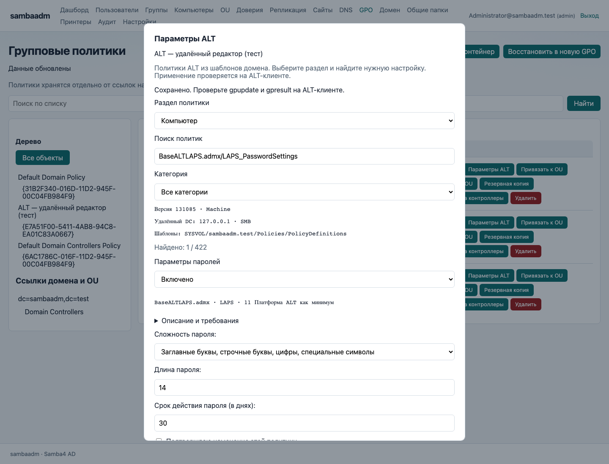
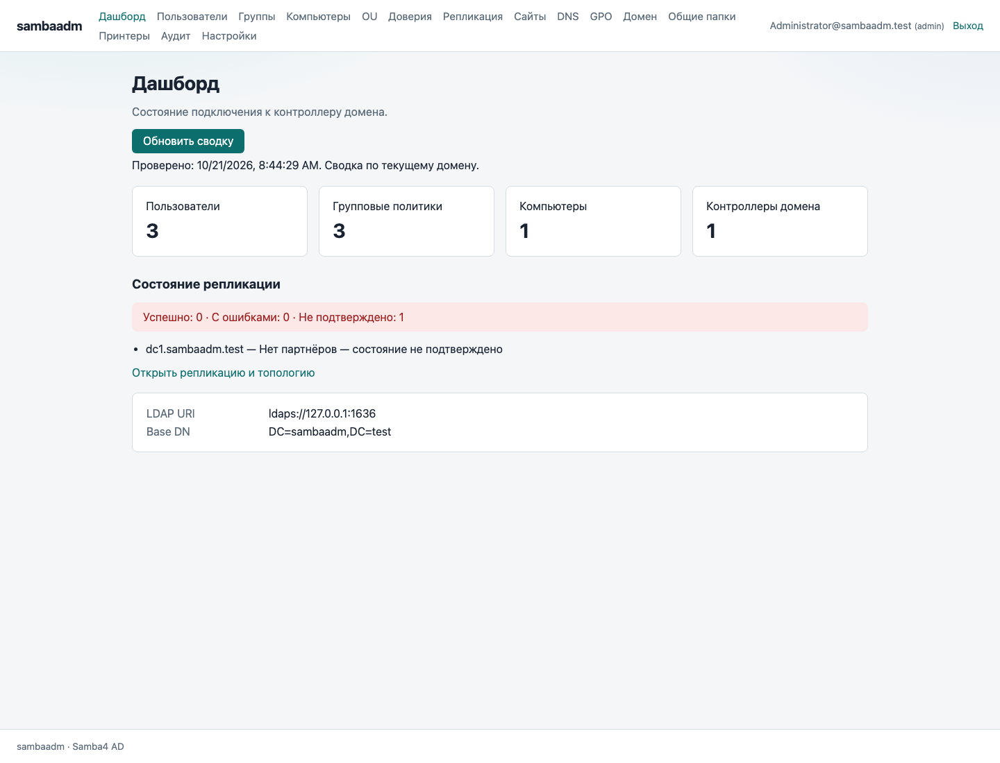
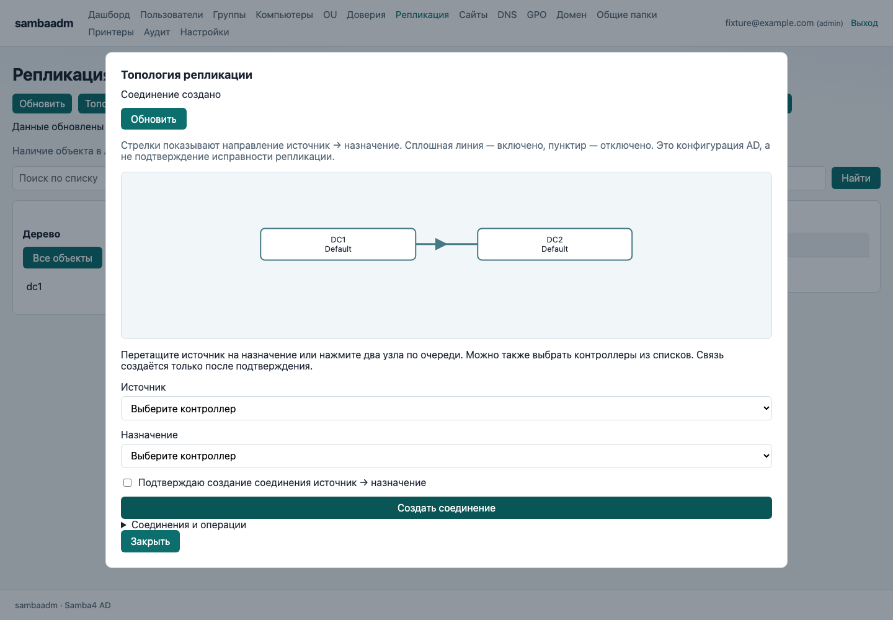
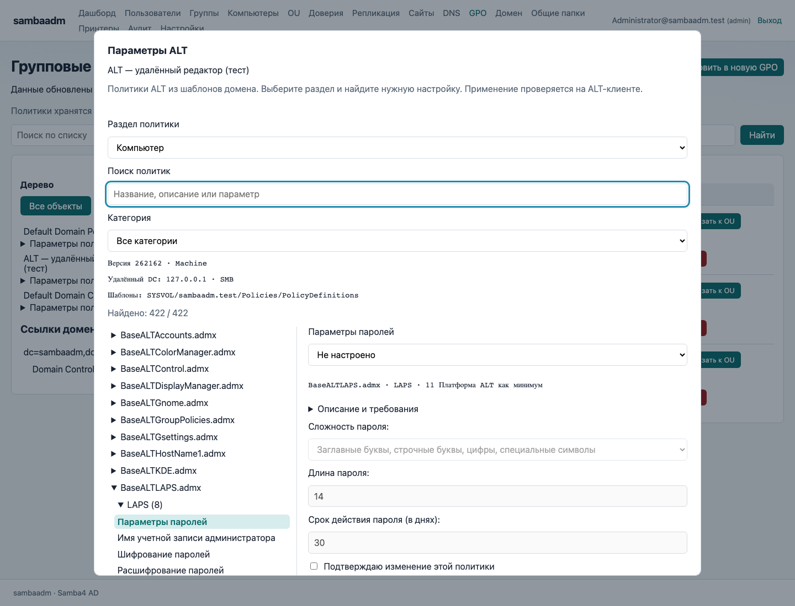
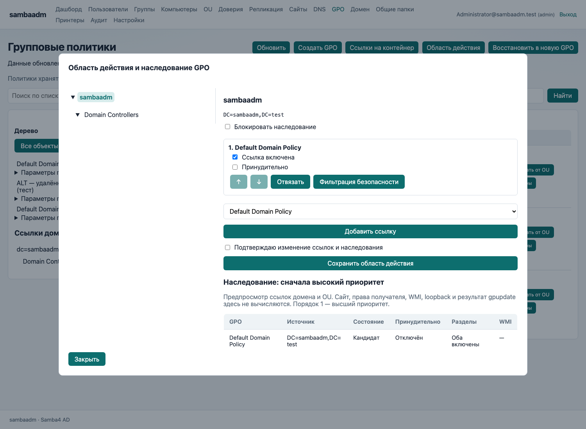
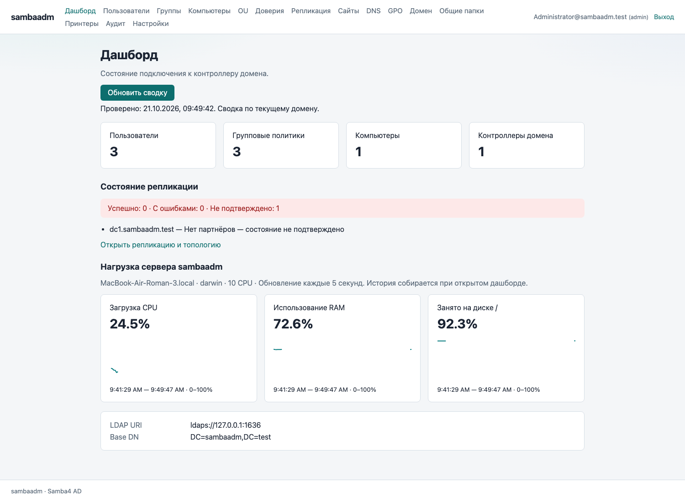

# Веб-интерфейс администратора

После входа откройте нужный раздел в верхнем меню. Интерфейс получает данные из подключённого домена; встроенного демонстрационного входа и стандартного пароля нет. Настройте LDAP URI, Base DN и группы ролей в YAML. Для передачи паролей используйте HTTPS и LDAPS или локальный ldapi. Веб-вход требует настроенных `ldap.bind.user` и пароля служебной записи в `password_env`: эта запись обслуживает операции приложения, а пароли входящих пользователей проверяются на отдельных соединениях.

## Каталог

В «Пользователях», «Группах», «Компьютерах» и OU слева находится раскрывающееся дерево. Оно строится из DN и включает подразделения и стандартные контейнеры, например CN=Users. Выбор контейнера показывает его объекты и вложенные подразделения; выбор пользователя — одну запись. «Все объекты» снимает выбор. Поиск фильтрует загруженный список, «Обновить» перечитывает данные.

У пользователя доступны свойства, создание, включение и отключение, сброс пароля с повторным вводом, перенос в другой OU и удаление. В группах — свойства, список участников, создание, добавление и исключение участника по DN, удаление. Компьютеры можно просматривать, переносить и удалять. OU можно создавать, переносить и удалять; сервер AD отклонит удаление непустого подразделения.

В формах назначения OU можно выбрать DN из подсказок. Пароли после успешного выполнения очищаются и не выводятся в результатах. При переносе меняется область действия групповых политик — проверяйте целевой DN.

## DNS

Дерево содержит зоны. Раскройте «Имена записей», чтобы загрузить имена из DNS-разделов LDAP. Выберите имя, затем «Показать», чтобы запросить записи через нативный DNS RPC. Если права на чтение раздела не позволяют загрузить дерево, запись можно запросить вручную кнопкой «Записи» или «Запросить запись».

В строке зоны доступны создание, изменение и удаление записей; для изменения нужны точное прежнее и новое значения. Имя задаётся относительно зоны, @ означает её корень. Поддерживаются A, AAAA, CNAME, MX, NS, PTR, SRV и TXT. Для сложных типов используйте форматы SRV `target port priority weight`, MX `target preference`, TXT в кавычках. Результаты содержат тип и данные записи.

Также можно создавать и удалять зоны. Удаление зоны затрагивает её содержимое и требует подтверждения. Не используйте служебные зоны AD для пробных изменений.

## GPO

Слева показаны политики и дерево домена/OU. Выбор OU открывает запрос его ссылок GPO. Для политики доступны свойства, создание, привязка и отмена привязки к контейнеру DN, резервная копия, восстановление, удаление и доставка SYSVOL на контроллеры.

Каталог резервной копии находится на сервере приложения. При доставке отображаются прогресс, шаги, ошибки и итог. Закрытие окна прекращает наблюдение в браузере, но не отменяет задание на сервере.

«Параметры ALT» редактирует поддерживаемые административные шаблоны ADMX и Registry.pol. Нужны gpo.editor_enabled и доступный источник шаблонов. Кнопка «Сценарии» отдельно открывает scripts.ini и psscripts.ini из SYSVOL без ADMX и без включения редактора ALT. Admin может добавлять, менять, переставлять и удалять назначения, загружать и заменять файлы; другие роли просматривают назначения и скачивают файлы. Сохраняется только выбранное событие/тип; доступна резервная копия и проверка конфликтов с GPUI. Полный набор расширений GPUI не поддерживается. Применение на клиенте проверяется отдельно, например через gpresult.

## Остальные разделы

«Домен» показывает FSMO, свойства и функциональные уровни; доступны передача и аварийный захват роли, повышение уровня. «Репликация» — контроллеры, структурированное состояние по разделам и направлениям, синхронизация с источником и при необходимости заданным назначением/разделом, соединения и пересчёт KCC. «Сайты» — дерево сайтов с DC и подсетями, перенос DC, назначение подсетей и связи сайтов со стоимостью и интервалом. «Доверия» — создание, проверка и удаление.

«Общие папки» — создание, свойства, изменение параметров Samba, права Samba/POSIX ACL и расширенные атрибуты, удаление публикации, перечитывание конфигурации. По умолчанию удаление публикации сохраняет каталог и его данные. «Принтеры» — список, создание публикации очереди CUPS и удаление. «Аудит» и «Настройки» сохраняют свои экраны; настройки меняют язык.

## Права и зависимости

readonly получает просмотр; helpdesk дополнительно может включать, отключать пользователей и сбрасывать пароли; admin — остальные изменения. Сервер проверяет роль и CSRF независимо от видимости кнопки. Для опасных действий форма запрашивает подтверждение. Ошибка сервера сохраняет введённые данные, чтобы их можно было исправить.

Роль приложения не заменяет полномочия AD и права процесса в ОС. Доменные операции v0.20.0 используют LDAP, RPC и SMB без samba-tool. Для ACL нужны getfacl/setfacl, для атрибутов getfattr/setfattr, для печати lpstat. Доставка GPO использует RPC и SMB-доступ к SYSVOL. Ограничения systemd должны разрешать необходимые пути.

## Проверка разработчиком

`go test ./...` проверяет HTTP-маршруты, роли, CSRF, валидацию, построение DN-дерева и вызовы утилит. `go vet ./...` выполняет статические проверки.

Для браузерных контрактных тестов установите Playwright в доступном Node.js окружении и запустите `node testdata/web/workspace.cjs`. При необходимости задайте `NODE_PATH` и `PLAYWRIGHT_CHROMIUM_EXECUTABLE`. Тест сам создаёт временный HTTP-сервер с настоящими шаблонами, подменяет ответы API учебными данными и удаляет временные файлы. Производственный домен не используется. `SAMBAADM_WEB_SCREENSHOTS` задаёт каталог снимков.

Эти проверки не подтверждают совместимость конкретных команд с установленной на вашем контроллере версией Samba. Перед рабочими изменениями проверьте операции на тестовом домене.

### Резервная копия и восстановление GPO

Действие копирования сохраняет политику в `<каталог>/policy/{GUID}` на сервере.
Восстановление доступно в панели GPO: укажите новое имя и полный путь к этой
папке политики. Будет создана новая GPO с новым GUID; привязки к OU добавляются
отдельно. Существующая политика не перезаписывается.
API: `POST /api/v1/gpo/restore`, JSON `{"name":"Новое имя","path":"/backup/policy/{GUID}"}`.

Нативные RPC/SMB-операции используют настроенную служебную учётную запись LDAP.
Пароль передаётся через временный файл с правами 0600, удаляемый после команды.
Для входа и смены пароля используйте LDAPS с доверенным сертификатом;
Samba может отклонять simple bind через ldapi с `StrongAuthRequired`.

### Политики для клиентов ALT Linux

Целевая совместимость включает «Альт Домен»: GPUI редактирует параметры,
GPUpdate применяет их на клиенте, GPResult формирует отчёты. Серверные
операции GPO и проверка SYSVOL уже проверены на Samba; применение настроек
на ALT SP Workstation 10.2.2 пока не проверено.
[Состав комплекса](https://www.basealt.ru/alt-domain).

Для редактора нужны шаблоны ALT (`admx-basealt`) и отдельные разделы
Machine/User. Политики systemd, control и браузеров зависят от поддержки
клиентских модулей. Не все параметры Windows имеют эквивалент на ALT.
[Политики в ветке 10.4](https://docs.altlinux.org/ru-RU/domain/10.4/html/alt-domain-p10/gp--chapter.html).

План реализации: чтение административных шаблонов, согласованная запись
файлов политики и версий LDAP/GPT.INI, затем проверка результата на ALT-клиенте
через gpupdate и gpresult. Доставка SYSVOL сама по себе не подтверждает
применение настройки. Доступные модули и версии пакетов следует сверять
именно с установленной веткой СП, а не переносить возможности 11.x.
[Клиентский механизм](https://docs.altlinux.org/ru-RU/domain/10.4/html/alt-domain-p10/gpupdate.html).

### Редактор административных политик ALT



В GPO выберите «Параметры ALT», затем раздел «Компьютер» или «Пользователь».
Редактор загружает все `BaseALT*.admx` из настроенного каталога. В наборе
[admx-basealt](https://github.com/altlinux/admx-basealt/tree/8205b08f69dc9365c92bfd8451b2863f757d356b)
проверены 24 файла, 667 определений и 687 вариантов по разделам: 422 машинных
и 265 пользовательских (политики `Both` доступны в обоих разделах).

Доступны systemd, Control, Polkit, GNOME/MATE и GSettings, KDE, LAPS,
установка/удаление пакетов, параметры GPUpdate и остальные административные
шаблоны набора. Это редактор ADMX; настройки предпочтений GPO в отдельных XML
(например, файлы или ярлыки) не становятся ADMX-политиками.

Поиск работает по названию, описанию, идентификатору и параметрам. Есть фильтр
категорий и дерево «шаблон → категория → политика». Справа открывается форма только выбранной политики; поиск раскрывает подходящие ветви. Русские подписи, пояснения и
начальные значения берутся из `ru-RU/*.adml`, при отсутствии — из `en-US`;
без ADML видны идентификаторы. Допустимые варианты и диапазоны берутся из ADMX.

Формы поддерживают строки, числа DWORD, перечисления со строковыми/числовыми
значениями, флаги и аддитивные списки (по одному значению в строке), включая
политики с несколькими параметрами. «Не настроено» удаляет только записи выбранной
политики. «Отключено» записывает disabledValue или маркеры удаления её значений.
Пустой список не имеет отдельного состояния в Registry.pol: используйте
«Не настроено». Неизвестные типы и значения доступны только для просмотра;
редактор не подменяет их значениями по умолчанию.

Включение на Mac или другом сервере приложения:

```yaml
gpo:
  editor_enabled: true
  admx_path: ""
  smb_port: 445
```

При пустом `admx_path` шаблон читается через SMB из центрального хранилища:
`\\<DC>\SYSVOL\<DNS-домен>\Policies\PolicyDefinitions`.
Разместите там `BaseALT*.admx` из пакета `admx-basealt`, соответствующего вашим клиентам,
и языковые файлы ADML в подкаталогах `ru-RU`/`en-US`.
Это можно сделать с Mac по SMB; устанавливать шаблоны или монтировать SYSVOL
на Mac не требуется. Если центрального хранилища пока нет, можно явно указать
локальный каталог шаблонов или один ADMX через `admx_path`; файлы самой GPO всё равно читаются и
записываются удалённо. Источник шаблона и адрес DC показаны в редакторе.

LDAP должен указывать на конкретный writable DC. SMB подключается к этому же
хосту с теми же служебными реквизитами, без DFS-переадресации на другой DC.
Для рабочего домена нужен порт 445; для тестового стенда Mac — 1445.
Служебной записи нужны права на чтение шаблона, изменение файлов GPO и её
LDAP-атрибутов. Новый Registry.pol наследует доменные ACL через SMB;
существующие файлы меняются на месте с сохранением владельца и ACL.
Локальный SYSVOL, Python Samba, SSH и samba-tool для редактора не нужны.
По умолчанию редактор отключён. Старый `sysvol_path` на него больше не влияет.

Просмотр доступен вошедшим пользователям; сохранение — роли admin с CSRF.
Выберите состояние политики, заполните её параметры, подтвердите изменение и нажмите «Сохранить».
Редактор сохраняет остальные записи Registry.pol. Машинные параметры меняют
`Machine/Registry.pol`, младшие 16 бит версии и `gPCMachineExtensionNames`;
пользовательские — `User/Registry.pol`, старшие 16 бит и `gPCUserExtensionNames`.
Другая часть версии и посторонние расширения сохраняются.
При устаревшей ревизии перезагрузите параметры и повторно оцените изменение.
Не редактируйте ту же GPO одновременно в GPUI или другой программе.

Отсутствие настройки не гарантирует возврат клиента к состоянию до применения
политики: фактическое состояние проверяется на клиенте. Пакеты и возможности
должны соответствовать вашей ветке ALT СП. Проверка чтения файла парсером Samba
и HTTP-тесты пройдены; применение на ALT СП 10.2.2 ещё не проверено.

#### Сбой сохранения

Перед записью создаётся `.sambaadm-editor.pending` в каталоге GPO. При явном
отказе LDAP изменения файлов откатываются. Если результат LDAP неизвестен из-за
обрыва связи или процесс был прерван, журнал остаётся, дальнейшее редактирование
блокируется. Журнал создаётся эксклюзивно через SMB, после чего ревизия
проверяется ещё раз; это защищает от одновременного сохранения несколькими
экземплярами sambaadm на одном DC. LDAP-запись проверяет также `uSNChanged`.
Файловая система и LDAP не образуют единую транзакцию.

Журнал доступен с Mac через SMB в каталоге этой GPO.
Не удаляйте журнал до проверки администратором. Он содержит версии `Version`
и `NextVersion`, признак `RegistryExisted` и исходные/новые байты файлов в base64:
`Registry`, `GPTINI`, `RegistryAfter`, `GPTINIAfter`. Имена файлов указаны в
`RegistryPath` и `GPTINIPath`. Сравните текущую версию LDAP,
расширения и содержимое SYSVOL с журналом. При подтверждённом сохранении
проверьте новые файлы и версию; при откате восстановите исходные файлы и
согласуйте LDAP. Сохраните журнал вне SYSVOL для разбора, затем удалите его
из каталога политики. После восстановления проверьте репликацию и применение.

### Карточка пользователя

В разделе «Пользователи» нажмите «Свойства». Карточка разделена на вкладки «Атрибуты», «Расширенные атрибуты» и «Группы». Она показывает логин, UPN,
DN и состояние учётной записи. Admin может изменить отображаемое имя, имя,
фамилию, почту, телефон, подразделение организации, должность и описание.
Сохранение отправляет только изменённые поля; пустая строка удаляет атрибут.
Название подразделения в карточке — атрибут department, а перенос в OU
выполняется отдельной операцией «Переместить».

«Расширенные атрибуты» содержит контакты (инициалы, офис, веб-страница,
мобильный/домашний телефон, пейджер, факс), адрес (улица, город, регион,
индекс, название страны), организацию, отделение и табельные идентификаторы.
Ниже показаны доступные текстовые LDAP-атрибуты учётной записи: руководитель,
время создания/изменения, accountExpires, pwdLastSet, lastLogonTimestamp,
lockoutTime, badPwdCount, userAccountControl, primaryGroupID и пути профиля.
Временные значения показываются в исходном LDAP-формате, включая FILETIME.
Это ограниченный набор атрибутов, а не полный аналог всех вкладок ADMC:
безопасность и делегирование здесь не редактируются. Секретные атрибуты не запрашиваются.

Поиск работает при вводе по загруженным именам, логинам, почте и атрибутам,
включая кириллицу; несколько слов могут встречаться в разных полях. Область
поиска ограничена выбранной ветвью дерева. Для поиска по всему домену нажмите
«Все объекты». В формах создания и переноса кириллические OU отображаются
читаемо; специальные символы DN, например запятая в имени OU, остаются экранированными.

Логин, UPN и DN в этой форме доступны для просмотра. Для включения,
отключения, смены пароля и переноса используются отдельные действия с прежними
проверками ролей. Роль helpdesk может менять состояние и сбрасывать пароль;
атрибуты и членство в группах изменяет admin.

Список групп включает прямое членство и основную группу AD. Вложенные группы
не разворачиваются. Основная группа отмечена отдельно и не имеет кнопки
исключения. Для добавления найдите группу по имени, затем нажмите «Добавить в …»;
для удаления прямого членства — «Исключить из …». Действия применяются сразу.

При конфликте сохранения введённые значения остаются в форме, повторная запись
блокируется. Нажмите «Перезагрузить карточку», сравните данные и внесите нужные
изменения заново. Проверка основана на uSNChanged и LDAP assertion control;
используйте подключение к одному контроллеру.

API: `PUT /api/v1/users/{login}` принимает `revision` из GET пользователя и
выбранные поля атрибутов. Устаревшая ревизия возвращает 409, неизвестные поля
(включая enabled/password) — 400. `GET /api/v1/users/{login}/groups` возвращает
`dn`, `name`, `primary`; операции членства используют API групп. Изменения
атрибутов и групп записываются в аудит.

## Сайты и репликация (v0.11.0)

В «Сайты → Топология сайтов» показаны контроллеры и подсети каждого сайта. «Контроллеры» позволяет перенести сервер в существующий сайт и проверить его репликацию. Созданный сайт содержит стандартные дочерние объекты Servers и NTDS Site Settings. Удаление занятого сайта запрещено: сначала перенесите DC, переназначьте подсети и удалите ссылки из связей сайтов.

«Связи сайтов» показывает IP Site Links. Можно создать и удалить связь, выбрать сайты (имена через точку с запятой), изменить стоимость 1–32767 и интервал 15–10080 минут с шагом 15. Новая связь требует двух разных сайтов. Запись расписания Site Link заблокирована: в проверенной Samba 4.17 KCC ошибочно читает siteList вместо schedule и падает. Ограничение действует до проверки исправления у поставщика. Расписание **соединения репликации** задаётся отдельно: семь дней, начиная с воскресенья, **в UTC**. Пример рабочего дня: `08:15-12:00,13:00-18:45`. Пустой день запрещает репликацию, `00:00-24:00` разрешает весь день; переход через полночь разбивается на два дня. Это доступность репликации, а не обещание запуска в точную минуту.

В «Репликация → Соединения репликации» доступны ручное создание направления источник → назначение, включение/отключение, расписание UTC и удаление. Автоматические соединения поддерживает KCC, который может пересоздать их. После изменения топологии выполните «Пересчитать топологию KCC» для нужного DC, затем «Состояние репликации». Изменения Configuration также должны дойти до остальных контроллеров; KCC не заменяет передачу изменений каталога.

Статус показывает направление, партнёра, раздел, число последовательных ошибок, последний успех и результат попытки. Список зарегистрированных DC сам по себе не подтверждает исправность; отсутствие партнёров отображается отдельно. Ошибка RPC возвращается как ошибка, а не успешный пустой результат. Для RPC нужны доступные порты контроллера, DNS/сеть и полномочия служебной учётной записи.

Изменение связей, соединений и перенос DC используют версию объекта. При конфликте (HTTP 409) закройте форму, заново откройте список и повторите изменение с актуальными данными. Все изменения доступны admin с CSRF и подтверждением в интерфейсе; readonly/helpdesk могут смотреть топологию и состояние.

DRS-синхронизация передаёт выбранный раздел AD; она **не копирует файлы SYSVOL**. Для GPO используйте отдельную доставку SYSVOL и проверяйте gpupdate/gpresult на клиенте ALT. Применение политик на ALT СП 10.2.2 ещё не проверено.

Формат расписания соответствует [SCHEDULE_HEADER Microsoft](https://learn.microsoft.com/en-us/windows/win32/api/schedule/ns-schedule-schedule_header); команды диагностики — [samba-tool](https://www.samba.org/samba/docs/current/man-html/samba-tool.8.html).

Ограничение Site Link подтверждено стендом и [исходником Samba 4.17](https://github.com/samba-team/samba/blob/samba-4.17.12/python/samba/kcc/kcc_utils.py). При сохранении расписания соединения устанавливается флаг пользовательского расписания, чтобы KCC не заменял его автоматически. Отсутствующее расписание соединения отображается как закрытые дни.

## Отладка запуска v0.11.1

Запуск с диагностикой: `sambaadm serve --config /etc/sambaadm/config.yaml --listen=:8081 --debug`. Также работают `--verbose` (`-v`), `SAMBAADM_LOGGING_LEVEL=debug` и `logging.level: debug` в YAML. Флаги debug/verbose имеют приоритет над уровнем в конфигурации.

В stderr выводятся версия и платформа, реально выбранный файл конфигурации, рабочий каталог, адрес HTTP, TLS, LDAP URI и Base DN, имя служебной учётной записи, имя переменной пароля и признак её наличия, пути Samba/SYSVOL/ADMX и доступность утилит. Значение пароля, тело HTTP-запроса и полный список переменных окружения не выводятся. Проверяются служебный LDAP-вход и чтение Base DN; ошибки DNS, подключения, TLS и Bind показываются с подсказкой. Debug также включает журнал HTTP с методом, путём, статусом и длительностью.

Проверка LDAP без запуска веб-сервера: `sambaadm serve --config /etc/sambaadm/config.yaml --check`. Код 0 означает успешный служебный Bind и чтение Base DN; ненулевой код — ошибку настройки или LDAP. Отсутствие необязательных утилит выводится предупреждением: такая проверка не подтверждает работоспособность всех операций Samba/GPO. Обычный запуск с debug продолжает запуск HTTP при недоступном LDAP, чтобы можно было открыть интерфейс; ошибка открытия HTTP-порта завершает процесс. Сообщение «listening» появляется только после открытия порта.

Для сохранения лога: `sambaadm serve --config /etc/sambaadm/config.yaml --debug 2> sambaadm-debug.log`. Для systemd задайте `SAMBAADM_LOGGING_LEVEL=debug` в EnvironmentFile сервиса (`/etc/sambaadm/env`), перезапустите сервис и смотрите `journalctl -u sambaadm -b -f`.

Подробности v0.20.0: [нативное подключение с Mac](mac-domain.md).


## Дашборд и карта репликации

Дашборд показывает общее количество пользователей, GPO, компьютеров (включая
контроллеры) и контроллеров текущего домена. Кнопка «Обновить сводку» повторяет
проверку. Состояние репликации запрашивается отдельно у каждого DC, не более
трёх одновременно. Ошибка запроса и отсутствие партнёров считаются
неподтверждённым состоянием, а не успешной репликацией. При недоступности
списка объектов вместо нуля отображается «Недоступно».

В разделах «Репликация» и «Сайты» кнопка «Топология» открывает карту
контроллеров и направленных соединений. Сплошная стрелка означает включённое
соединение, пунктир — отключённое. Карта отражает конфигурацию AD; текущую
исправность проверяйте по состоянию репликации. В разворачиваемом списке
соединений доступны прежние операции и расписания, включая признак KCC.

Администратор может перетащить контроллер-источник на контроллер назначения,
нажать два узла по очереди или выбрать их из списков. Перед отправкой видны
точные имена и направление; затем требуется подтверждение и нажатие
«Создать соединение». Соединение с самим собой и повторное соединение в том
же направлении не отправляются. Пользователи с правами просмотра могут
открыть карту, но не создавать связи. Для связей сайтов и операций с
контроллерами используются списки существующих объектов.

В дереве GPO доступны ветви свойств и параметров ALT. Вложенные свойства
раскрываются по отдельности; каталог ALT показывает одну форму за раз.







## Область действия и фильтрация GPO

Кнопка **«Область действия»** и узлы дерева домена/OU открывают ссылки выбранного
контейнера. Добавьте существующую GPO из списка, измените порядок кнопками ↑/↓,
включите или отключите ссылку, задайте принудительное применение и блокировку
наследования. Изменения отправляются после подтверждения кнопкой сохранения.
Порядок 1 — высший приоритет в контейнере. Ссылки и gPOptions сохраняются одной
LDAP-операцией с проверкой uSNChanged; конфликт требует перезагрузки данных.

Ниже отображаются кандидаты по ссылкам домена/OU и причины исключения:
отключённая ссылка, блокировка наследования, отсутствующая GPO либо неизвестные
параметры. Принудительные ссылки переживают блокировку наследования. Это
предпросмотр структуры, **не RSoP**: сайт компьютера, токен пользователя/компьютера,
членство в группах, WMI, loopback и исполнение расширений на клиенте здесь не
вычисляются. Статус разделов Machine/User и ссылка WMI показываются отдельно.

**«Фильтрация безопасности»** показывает DACL GPO. Можно добавить явное
разрешение Apply Group Policy для выбранного пользователя, компьютера или
группы безопасности и удалить отдельную явную ACE этого права. Остальные
ACE сохраняются; совмещённые, наследуемые и запрещающие ACE доступны для
просмотра. Запись ограничена DACL через LDAP SD Flags и защищена uSNChanged.
Чтение GPO и SYSVOL необходимо отдельно: эта операция его не предоставляет и
не меняет файловые ACL. Удаление отдельного разрешения не означает запрет —
оно может оставаться через другую группу. Проверяйте gpresult на клиенте.

Правила: [MS-GPOL — поиск и порядок GPO](https://learn.microsoft.com/en-us/openspecs/windows_protocols/ms-gpol/5c7ecdad-469f-4b30-94b3-450b7fff868f),
[право Apply Group Policy](https://learn.microsoft.com/en-us/windows/win32/adschema/r-apply-group-policy).

## Мастер общих папок и профили Samba

В **«Общие папки → Создать папку»** основная форма требует имя, режим доступа
и группы из подключённого домена. Путь можно оставить пустым для стандартного
корня shares_root. «Рассчитать параметры» показывает будущие valid users,
write list, маски и POSIX ACL. Гости запрещены. Группы задаются квалифицированными
именами домена, а файловые ACL — локальными числовыми GID. На Linux разрешение
групп выполняется через getent/NSS, в том числе в статической сборке.

Машина с sambaadm должна быть настроена для работы с выбранным доменом и иметь
Samba, getent, setfacl и необходимые права. Если группы не разрешаются локально,
создание блокируется с объяснением. На Mac без локальной Samba и доменных
NSS-групп это ожидаемое ограничение: подключение по LDAP к DC не делает Mac
файловым сервером домена. Расширенная ручная форма остаётся в закрытой ветви.

В **«Настройки → Профили Samba»** доступны два профиля:

- Совместимый: SMB2_02 и выше, обязательная подпись, ограничение размера журнала.
- Защищённый: SMB3_11, обязательная подпись и шифрование, ограничение журнала.

Параметры рассчитываются по выбранному профилю; это не аппаратный автотюнинг.
Домен, server role, idmap и отдельные секции папок не переписываются. При
include, registry backend или неоднозначной конфигурации автоматическая запись
блокируется. Перед записью проверяются версия файла и testparm, создаётся
отдельная резервная копия; сохраняются режим и владелец основного файла.
Затем можно отдельно перечитать Samba. Некоторые параметры потребуют
перезапуска службы, а строгий профиль несовместим со старыми клиентами.
Конфигурация относится **к серверу sambaadm**, а не к удалённому DC.
Параметры описаны в [официальном smb.conf](https://www.samba.org/samba/docs/current/man-html/smb.conf.5.html).

## Графики нагрузки

На дашборде отображаются CPU, использованная RAM и доля занятого места на
системном диске машины sambaadm. Интервал — 5 секунд, в памяти сохраняются
последние 120 замеров. Сбор идёт при открытом дашборде, останавливается в
скрытой вкладке и сбрасывается при перезапуске сервера. Первый замер CPU и
ошибки сбора показываются как отсутствие данных, без искусственных нулей.
График диска показывает заполнение, а не скорость дисковых операций.





## Файловый журнал событий приложения

Добавлено в main после v0.23.0. Для `serve` и `serve --check` можно включить
отдельный журнал событий, сохранив аудит действий в прежнем JSONL-файле:

```yaml
audit:
  file: /var/log/sambaadm/audit.log
logging:
  level: info
  file: /var/log/sambaadm/events.log
```

Альтернативы: `SAMBAADM_LOGGING_FILE=/var/log/sambaadm/events.log` либо
`serve --log-file=/var/log/sambaadm/events.log`. Приоритет: флаг, переменная
окружения, YAML. `--log-file=""` отключает файловый журнал для этого запуска.
Вывод в stderr (и journalctl при systemd) сохраняется. Без logging.file
поведение остаётся прежним. Это настройка веб-сервера, а не остальных команд CLI.

Каталог должен существовать и быть доступен пользователю сервиса. Новый файл
создаётся с правами 0600; права существующего файла задаёт администратор.
При запуске файл дописывается, предыдущие события не стираются. Совпадение
с audit.file, включая существующие ссылки на тот же файл, запрещено.
Если открыть журнал не удалось, сервер не запускается; ошибка видна в stderr.
При ошибке записи во время работы события продолжают выводиться в stderr,
туда же однократно выводится предупреждение до восстановления записи.

Формат — текстовые строки с временем, уровнем, сообщением и полями. `info`
включает запуск, адрес прослушивания, завершение, предупреждения и ошибки.
HTTP 4xx пишутся как warn, 5xx — error; успешные запросы и подробная диагностика
подключения доступны при `--debug` или logging.level: debug. Уровни warn и error
дополнительно отфильтровывают менее важные сообщения. Ошибки после инициализации
журнала, например занятый порт или неполная TLS-конфигурация, также сохраняются.
Ошибки чтения самого YAML и открытия журнала остаются в stderr.

HTTP-журнал содержит метод, путь без query string, статус и длительность;
тела запросов, Cookie и Authorization не записываются. Настроенный пароль
служебной записи маскируется в текстовых сообщениях и ошибках. Имена объектов
в путях могут содержать внутренние данные — ограничьте доступ к журналу.
Журнал не является полной трассировкой RPC или заменой аудита.

```bash
sambaadm --config /etc/sambaadm/config.yaml serve \
  --log-file=/var/log/sambaadm/events.log --debug
tail -f /var/log/sambaadm/events.log
```

При systemd штатный путь /var/log/sambaadm уже разрешён в ReadWritePaths;
для другого каталога добавьте разрешение в unit и выдайте файловые права.
Автоматической ротации в приложении нет. Для ротации без потери записей
остановите сервис, переименуйте журнал и запустите его снова: новый файл
создастся при запуске. Простое переименование без перезапуска оставит запись
в прежнем открытом файле. Настройте срок хранения по правилам организации.

### Установка сервиса и отказ в доступе к репликации

Из каталога исходников запустите `sudo sh deploy/install.sh /путь/к/sambaadm-linux-amd64`.
Скрипт создаёт локальную учётную запись `sambaadm`, группу, каталоги и env-файл.
Заполните `/etc/sambaadm/config.yaml` и `/etc/sambaadm/env`, затем запустите сервис.
При обновлении существующая конфигурация сохраняется; необходим перезапуск сервиса.
В новой версии unit env-файл обязателен. В старом unit префикс `-` перед его путём
разрешал отсутствие файла, но не создавал его.

Различайте три учётные записи: `User=sambaadm` в systemd определяет права процесса
в локальной ОС; `ldap.bind.user` определяет доменные полномочия запросов LDAP/RPC/SMB;
пользователь веб-входа определяет роль в интерфейсе и автора аудита. Веб-вход
Domain Admin не заменяет `ldap.bind.user`. Не нужно запускать сервис от root,
чтобы устранить отказ доменного DC в доступе.

Ошибка `ERROR_DS_DRA_ACCESS_DENIED` при чтении статуса означает отказ DC
служебной доменной записи. Сообщение приложения теперь содержит имя этой записи
и адрес DC. Проверьте фактический config/env сервиса, затем полномочия именно этой
записи на этом DC; приложение автоматически права AD не повышает. Успешная
проверка `serve --check` подтверждает LDAP Bind и чтение Base DN, но не права DRS RPC.
После смены служебных реквизитов перезапустите сервис и повторите запрос статуса.
Отсутствие локальной записи `sambaadm` вызывает ошибку запуска systemd (например,
217/USER) ещё до открытия веб-интерфейса — это отдельная проблема.

### Моделирование результирующей политики (ALT Linux и Windows)

В разделе GPO выберите «Моделирование политики». Выберите пользователя и/или
компьютер либо домен/OU для условного получателя. Для проверки переноса задайте
целевую OU: объекты каталога при этом не перемещаются. Режим loopback задаётся
явно: None, Merge или Replace; Merge даёт пользовательским параметрам из
расположения компьютера более высокий приоритет.

Укажите допущения о безопасности (право применения и чтение GPO/SYSVOL) и WMI.
По умолчанию условия неизвестны; можно задать общее разрешение/запрет и исключения
для отдельных GPO. Эти значения используются для обоих разделов сценария и не
являются результатом проверки ACL или выполнения WMI на клиенте.

Расчёт учитывает ссылки домена и OU, их порядок, Enforced, блокировку наследования,
отключённые ссылки и разделы GPO. Параметры собираются из Registry.pol в SYSVOL:
в отчёте показаны итоговые состояния и значения поддерживаемых политик ALT из
ADMX/ADML, включая параметры, значения которых пришли из нескольких GPO.
«Не настроено» в одной GPO не отменяет настройки из другой.

Конфликты выделяются цветом и подписью «Конфликт»: разные значения или
установка/удаление одного значения в разных GPO. Раскройте сведения о конфликте,
чтобы увидеть значения конкурентов, победившую GPO, контейнер, Enforced и порядок
ссылки. Одинаковые значения разных GPO конфликтом не считаются. Развёрнутый список
Registry.pol показывает источники и приоритет также для параметров без шаблона ALT.
Отчёт вместе со сценарием и допущениями можно скачать в JSON.

Для расчёта нужны включённый `gpo.editor_enabled`, шаблоны ALT и SMB-доступ к SYSVOL,
как для редактора ALT. Расчёт доступен всем ролям приложения и ничего не записывает
в AD или SYSVOL. При ошибке чтения, неизвестном условии или неподдерживаемой
директиве Registry.pol раздел помечается как неполный: значения и победители
показаны только для обработанной части сценария.

Это ограниченная модель, а не полный серверный RSoP Windows RSAT. Политики сайта,
локальные политики, скрипты, Preferences, security templates, медленное соединение
и остальные клиентские расширения не моделируются. Loopback и применение каждой
политики зависят от движка политик конкретного ALT/Windows-клиента. Фактическое
применение проверяется на клиенте; LDAP и SYSVOL могут измениться во время чтения.

Даты AD в карточке пользователя отображаются в часовом поясе браузера с возможностью раскрыть исходное LDAP-значение. В списке и свойствах компьютеров показана дата создания. Управление составом групп предлагает поиск пользователей, групп и компьютеров и удаление из списка прямых участников; OU и контейнеры исключены из выбора. Ошибки прав на дашборде показывают причину и напоминают, что операции выполняются от ldap.bind.user.


## Копии и восстановление сценариев

В редакторе сценариев admin открывает «Резервные копии и восстановление». Экран доступен и при блокировке редактора незавершённым журналом. Он позволяет скачать журнал/копии, просмотреть возврат либо завершение записи, восстановить историческое состояние и удалить старые копии. Изменения требуют подтверждения актуального плана; внешние/частичные состояния отмечаются отдельно. Восстановление повышает версию GPO и предварительно сохраняет текущие данные. Новейшая копия защищена, очистка приостанавливается до завершения восстановления. По умолчанию сохраняется до 10 копий/64 МиБ, с сохранением хотя бы новейшей.

«Диагностика» показывает служебную запись и предлагает выбрать GPO. Отдельные результаты относятся к LDAP-атрибутам, чтению DRS и открытию GPT.INI с правом записи. Проверки не записывают данные и не запускают KCC; отсутствие сведений о правах помечается явно.

### Почему применяется GPO

В разделе GPO нажмите **Почему применяется GPO**, выберите пользователя, компьютер или их OU и нажмите **Объяснить применение**. Отчёт показывает путь домен → OU, блокировку наследования, источники ссылок, приоритет и порядок обработки условных кандидатов. Раскройте строку GPO под таблицей, чтобы увидеть каждое проверенное и неизвестное условие; для блокировки указан конкретный контейнер. Отчёт можно скачать в JSON. Изменение получателя очищает прежний результат.

Операция доступна readonly и не требует включённого редактора политик. «Условный кандидат» не означает подтверждённое применение: права получателя, SYSVOL, WMI, сайт, loopback и исполнение на клиенте проверяются отдельно. Для изменения допущений и расчёта параметров используйте существующее **Моделирование политики**.
