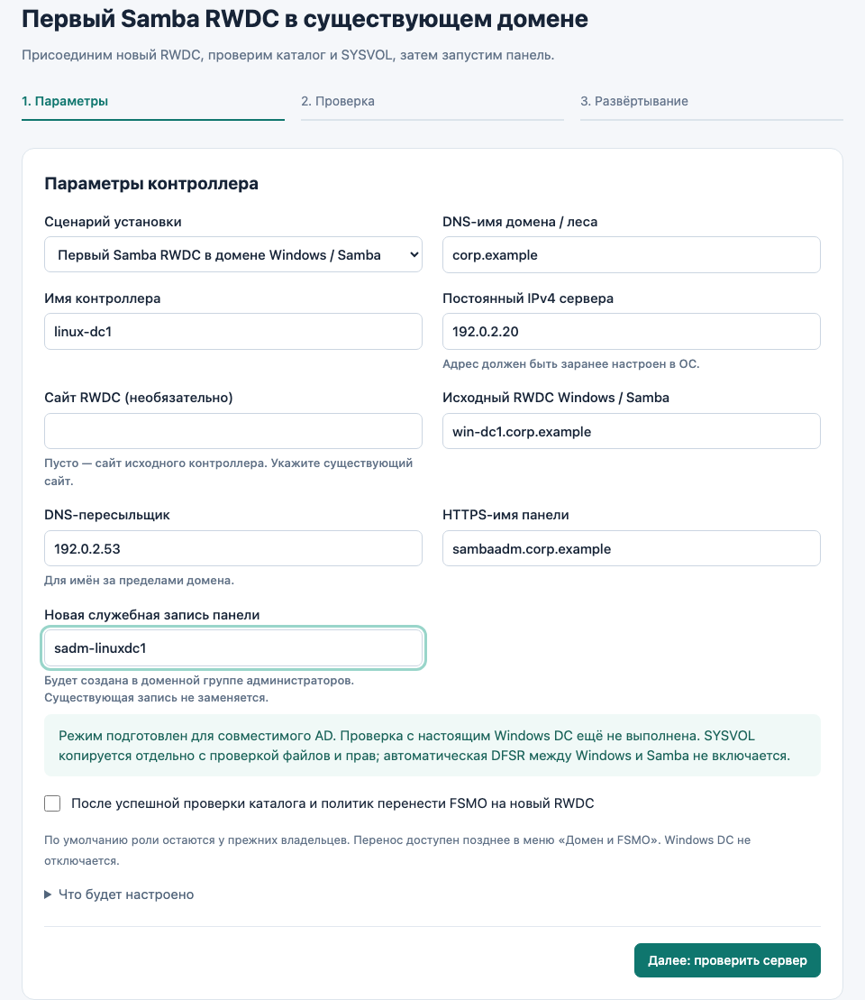
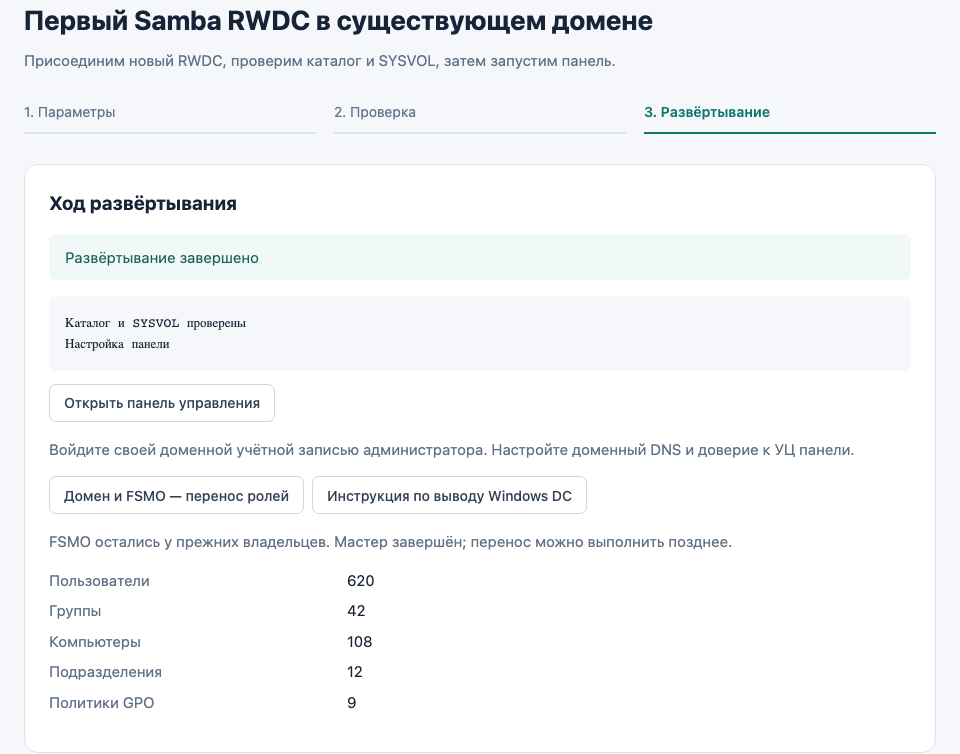

# Первый Samba RWDC в существующем домене Windows

Режим предварительной проверки. Присоединение, начальное копирование SYSVOL, продолжение после сбоя и настройка панели проверяются на изолированном Samba AD. **Проверка с настоящим Windows DC пока не выполнена: тестового Windows Server нет.** Перед применением к рабочему Windows AD необходим отдельный пилот с вашей версией Windows, уровнем леса, политиками и клиентами.

Иллюстрации используют учебный домен `corp.example` и адреса `192.0.2.0/24`; это примеры, а не отчёт проверки Windows.

## Что делает мастер

На чистом сервере ALT p10 или p11 полный пакет sambaadm запускает `sudo samba-domain-init`. В поле **Сценарий установки** выберите **Первый Samba RWDC в домене Windows / Samba**. Этот сценарий не создаёт новый лес: DNS-имя и SID существующего домена сохраняются.

Мастер сначала проверяет репозитории и скачивает необходимые пакеты. Затем проверяет исходный записываемый DC через Kerberos, определяет NetBIOS, сайт и функциональные уровни AD. Если уровень не поддерживается установленной Samba, присоединение блокируется. Версия Windows Server и функциональный уровень AD — разные параметры. Мастер не понижает и не повышает уровень существующего леса.

ALT p10 с Samba 4.19 допускает в этом мастере уровни до Windows Server 2008 R2. Для Samba 4.20 и новее предусмотрена проверка уровней до 2016 с явным параметром уровня DC; наличие этой возможности в Samba не заменяет пилот конкретного Windows AD. Уровень выше 2016 отклоняется. Установленные пакеты и возможности репозитория проверяются на самом сервере.

## Подготовка

1. Создайте резервную копию исходного AD и SYSVOL. Проверьте репликацию, DNS и время на существующих DC.
2. Подготовьте чистый ALT Linux: постоянный IPv4, systemd, доменный DNS и синхронизацию времени. Имя нового DC не должно совпадать с существующей учётной записью компьютера.
3. Проверьте доступность репозиториев и пакетов по [инструкции развёртывания](domain-init.md). Ошибки индексов или отсутствие кандидата пакета нужно исправить до установки.
4. Разрешите штатный доменный трафик между новым сервером и исходным RWDC, включая SMB, LDAP, Kerberos, DNS и RPC. Helper на Windows DC не требуется.
5. На время начального копирования остановите изменения GPO. Изменяющийся каталог или несовпадение LDAP/SYSVOL не позволяют подтвердить готовность нового DC.

## Параметры и запуск

Укажите DNS-имя существующего домена, имя и IPv4 нового RWDC, DNS-имя исходного RWDC, внешний DNS-пересыльщик и HTTPS-имя панели. Для служебной записи панели задайте новое имя: существующая запись не заменяется. Учтите, что мастер создаёт эту запись в группе администраторов домена; её случайный пароль хранится на сервере с ограничением доступа.

Поле сайта можно оставить пустым: будет выбран сайт исходного DC. Для другого размещения укажите существующий сайт. NetBIOS определяется из AD автоматически.

Переключатель **После успешной проверки каталога и политик перенести FSMO** по умолчанию выключен. Его значение входит в план до подтверждения. Введите доменную учётную запись с правами присоединения RWDC. Для Kerberos используйте основной UPN домена или `NETBIOS\логин`. Если выбран перенос FSMO, нужны также права на соответствующие доменные и лесные роли.

До готовности каталогов мастер запускает Samba только на loopback-интерфейсе. Он получает все разделы AD, включая DNS, сравнивает пользователей, группы, компьютеры, OU и GPO с источником, а затем отдельно копирует SYSVOL с проверкой содержимого, версий GPT.INI и прав. После успешных проверок включает доступ по сети, настраивает DNS, HTTPS, панель и локальный helper. Пароль администратора передаётся в памяти и не сохраняется в журнале или параметрах задания.

## SYSVOL при совместной работе

**Начальное копирование SYSVOL не является постоянной DFSR-репликацией между Windows и Samba.** Репликация объектов AD сама по себе не переносит файлы политик. Мастер не устанавливает такой канал автоматически.

До завершения пилота оставьте Windows DC включённым. Согласуйте единый источник изменения GPO; не редактируйте одну политику независимо на Windows и Samba. В этой версии отдельного мастера повторной синхронизации Windows SYSVOL ещё нет. Если исходные политики изменились после начального копирования, готовность к отключению Windows DC нужно пересмотреть и отдельно подтвердить доставку файлов, версии и ACL. Перенос FSMO не решает задачу SYSVOL.

## Завершение и продолжение после сбоя

Если перенос FSMO не выбран, мастер заканчивает настройку панели, сохраняя прежних владельцев ролей. Позднее откройте **Домен и FSMO** и выполните обычный перенос нужных ролей. Захват ролей и отключение Windows DC мастер не выполняет.

Если перенос выбран, отчёт содержит результат по каждой роли. Неудача или отсутствие подтверждения по отдельной роли не объявляются успешным переносом: проверьте владельцев и завершите перенос через меню. После прерывания этапа FSMO автоматическое повторение передачи не выполняется.

При сбое настройки панели после проверенного присоединения перезапустите `sudo samba-domain-init`, введите новый код из консоли, откройте исходное задание и нажмите **Продолжить настройку панели**. Повторно введите доменные учётные данные. Мастер проверит идентичность домена и RWDC и продолжит настройку без повторного присоединения и замены SYSVOL. Изменённый другим администратором конфиг не заменяется автоматически.

Продолжение доступно только после сохранённой контрольной точки готовности AD/SYSVOL/DNS. При более раннем сбое проверьте журнал и состояние нового DC вручную; новый лес поверх него создавать нельзя. Если установка helper началась, но не была подтверждена, проверьте его TLS и привязку в рабочей панели: автоматическая перезапись такой привязки блокируется.

## Порядок вывода Windows DC после пилота

Ссылка на эту инструкцию доступна в **Домен и FSMO**. Снятие роли Windows выполняется штатными средствами Windows; sambaadm не выключает и не удаляет Windows DC.

1. Убедитесь, что есть другие здоровые записываемые DC и глобальный каталог для нужных сайтов. Проверьте объекты, DNS, GPO, содержимое SYSVOL и права на новом Samba DC, а также реальный вход пользователей и применение политик на Windows и ALT клиентах.
2. В **Домен и FSMO** перенесите роли с выводимого Windows DC. На Windows проверьте `Get-ADDomain` и `Get-ADForest`; проверьте также владельцев инфраструктуры DNS-разделов в панели. При сомнениях оставьте старый DC включённым.
3. Перенесите зависимости: DNS клиентов и DHCP/Godhcp, источники времени после переноса PDC, LDAP/LDAPS-приложения и обращения к старому имени. Отдельно проверьте роли УЦ, файловые ресурсы и другие службы Windows.
4. На Windows откройте **Диспетчер серверов → Управление → Удалить роли и компоненты → AD DS → Понизить роль этого контроллера домена**. Укажите доменные полномочия и новый пароль локального администратора; проверьте предупреждения и выполните штатное снятие роли с перезагрузкой. Не выбирайте принудительное удаление или удаление последнего DC.
5. Альтернатива в повышенной PowerShell: `Uninstall-ADDSDomainController` с интерактивным вводом полномочий и локального пароля. Не передавайте пароль открытым текстом и не добавляйте `-ForceRemoval` для обычного вывода работающего DC.
6. После перезагрузки проверьте репликацию оставшихся DC, DNS и повторный вход клиентов. Удаляйте остаточные записи только после проверки их принадлежности снятому DC. Сервер после штатного снятия роли остаётся членом домена; удаление AD DS и выключение сервера — отдельные действия.

Основания: [Microsoft — штатное снятие роли DC](https://learn.microsoft.com/en-us/windows-server/identity/ad-ds/deploy/demoting-domain-controllers-and-domains--level-200-), [Microsoft — Uninstall-ADDSDomainController](https://learn.microsoft.com/en-us/powershell/module/addsdeployment/uninstall-addsdomaincontroller), [Microsoft — перенос FSMO](https://learn.microsoft.com/en-us/troubleshoot/windows-server/active-directory/view-transfer-fsmo-roles), [Samba — ограничения функционального уровня 2016](https://www.samba.org/samba/history/samba-4.20.0.html).
